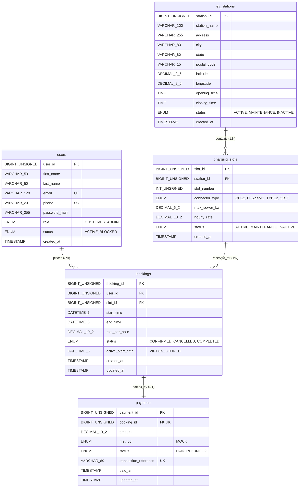

# SYSTEM ARCHITECTURE DOCUMENTATION
## EV Charging Slot Booking System

---

## Document Control & Metadata

| Attribute | Details |
|---|---|
| **Project Name** | EV Charging Slot Booking System |
| **Document Type** | System Architecture & Technical Specification |
| **Target System** | Java Swing + JDBC Desktop Application with MySQL Database |
| **Source Language** | Java 17 (Target/Source defined in `pom.xml`) |
| **Database Engine** | MySQL 8.0+ (InnoDB Storage Engine) |
| **Primary Artifact** | `SYSTEM_ARCHITECTURE.md` (Project Root) |
| **Author / Role** | Software Architect & Technical Documentation Engineer |
| **Target Audience** | Software Engineers, Academic Evaluators, DBMS Project Reviewers |

---

## 1. Project Overview

### 1.1 Purpose and Problem Statement
The **EV Charging Slot Booking System** is a standalone desktop software solution developed to address the scheduling, coordination, and availability challenges associated with Electric Vehicle (EV) charging infrastructure. 

With the rapid adoption of electric mobility, charging stations experience unpredictable traffic surges, peak-hour bottlenecks, and extended queue times. Traditional unmanaged charging networks suffer from:
1. **Blind Traveling**: Drivers travel to charging points without prior knowledge of whether compatible connectors or slots are functional or vacant.
2. **Double Allocations**: Uncoordinated reservations lead to overlapping customer arrivals and contention for physical hardware.
3. **Operational Inefficiency**: Station operators lack automated tools to track real-time utilization, toggle maintenance statuses, and evaluate station revenue and refunds.

This system provides a deterministic, pre-scheduled reservation platform where customers can discover nearby stations, inspect real-time connector specifications, verify slot availability, reserve slots in guaranteed 60-minute blocks, and complete simulated transactions. Simultaneously, administrators can oversee infrastructure status and generate revenue analytics.

### 1.2 Technology Stack
The technology stack is grounded strictly in the verified dependencies and source artifacts present within the repository:

| Layer / Aspect | Component / Technology | Specification & Version | Verification Source |
|---|---|---|---|
| **Runtime Environment** | Java SE Development Kit (JDK) | Java 17 LTS | `pom.xml` (`<maven.compiler.source>17</maven.compiler.source>`) |
| **User Interface (Presentation)** | Java Swing / AWT | `javax.swing.*`, `java.awt.*` | `com.evcharging.ui.*`, System Look & Feel |
| **Database Engine** | Relational Database Management System | MySQL 8.0+ (InnoDB Engine) | `dbcode.txt`, `README.md` |
| **Database Connectivity** | Java Database Connectivity (JDBC) | MySQL Connector/J `9.2.0` | `pom.xml` (`com.mysql:mysql-connector-j:9.2.0`) |
| **Build & Dependency Tool** | Apache Maven | Maven 3.x Object Model | `pom.xml` |
| **Security & Cryptography** | Java Cryptography Architecture (JCA) | PBKDF2 with HMAC-SHA256 | `com.evcharging.security.PasswordHasher` |
| **Execution Plugin** | Exec Maven Plugin | `org.codehaus.mojo:exec-maven-plugin:3.1.0` | `pom.xml` (Main: `com.evcharging.Main`) |

### 1.3 Application Type & Intended Actors
The application is structured as a **two-tier / three-tier client-server desktop architecture**. The Swing client executes locally on the user's desktop, encapsulating presentation and business logic, while connecting over standard TCP/IP JDBC sockets to a centralized MySQL database instance.

The system defines two primary actors governed by Role-Based Access Control (RBAC):
- **Customer (`UserRole.CUSTOMER`)**: An authenticated vehicle owner who can self-register, log in, browse active stations, inspect slots, book 1-hour slots, generate mock payment records, review past/upcoming bookings, and cancel active reservations with automatic refund processing.
- **Administrator (`UserRole.ADMIN`)**: A privileged operational user who logs in with pre-seeded administrative credentials to inspect network stations, place stations into `ACTIVE` or `MAINTENANCE` states, execute administrative backend operations, and extract station revenue reports using database stored procedures.

### 1.4 Scope and Capabilities
- **Verified Implemented Capabilities**:
  - Customer self-registration with duplicate checks (email and phone) and input format validation.
  - Secure credential storage using PBKDF2 password hashing (600,000 iterations, cryptographic salt, constant-time verification).
  - Multi-condition station search (name substring and city filter) restricted to active stations.
  - Connector inspection showing type, power rating (kW), hourly rate (₹), and operational status.
  - 1-hour aligned reservation with strict database transaction boundaries (`conn.setAutoCommit(false)`), pessimistic row-level locking (`FOR UPDATE`), and overlap interval detection.
  - Automated mock payment creation with unique alphanumeric transaction reference strings.
  - Customer booking history view with cancellation capabilities.
  - Trigger-driven refund synchronization (`trg_booking_cancel_payment`) ensuring financial auditability upon booking cancellation.
  - Administrative station maintenance toggling and stored-procedure-backed revenue analytics (`sp_station_revenue`).
- **Specified Requirements with Implementation Notes**:
  - *Admin Slot Management*: The backend classes (`AdminService.addSlot`, `SlotDAO.createSlot`, `SlotDAO.updateSlotStatus`) are fully implemented, but the current `AdminDashboardFrame` Swing GUI lacks graphical input forms to invoke them directly.
  - *Booking Model*: The model package contains enums for `BookingStatus`, but lacks a standalone `Booking.java` entity POJO; booking data is handled dynamically through query projections and Swing TableModels.

---

## 2. System Architecture

### 2.1 Architectural Pattern Overview
The application follows a **Layered Architecture** with distinct separation of concerns across presentation, business services, data access, and persistent storage. While user interface components are built with Java Swing, the interaction flow incorporates core tenets of the **Model-View-Controller (MVC)** and **Data Access Object (DAO)** patterns:

```
[Presentation Layer (Swing UI)]
       │
       ▼ (Invokes Business Methods & Passes Domain Data)
[Service Layer (Business Logic & Validation)]
       │
       ▼ (Invokes CRUD / Persistence Methods)
[Data Access Object (DAO) Layer]
       │
       ▼ (Executes Parameterized SQL Statements via JDBC)
[Database Connectivity & Driver (MySQL Connector/J)]
       │
       ▼ (TCP/IP Socket: Port 3306)
[MySQL 8.0+ Database (InnoDB Engine)]
```

### 2.2 Component Interaction & Communication Flow

1. **Presentation Layer (Swing GUI)**:
   - Built using standard Swing containers (`JFrame`, `JPanel`, `JTabbedPane`, `JScrollPane`, `JSplitPane`) and controls (`JButton`, `JTextField`, `JPasswordField`, `JTable`).
   - Executes UI event listeners on the Swing **Event Dispatch Thread (EDT)**.
   - Collects user inputs, converts GUI events into service invocations, and maps returned collections to `DefaultTableModel` rows for visual display.
   - Presents error notifications and validation feedback via modal dialogs (`JOptionPane.showMessageDialog`).

2. **Service Layer (Business Logic & Coordination)**:
   - Encapsulated in the `com.evcharging.service` package (`AuthService`, `BookingService`, `AdminService`).
   - Acts as the transaction orchestrator and gatekeeper for business integrity.
   - Enforces domain rules (e.g., verifying that booking times are strictly in the future, minutes are aligned to `:00`, operating hours are respected, and stations/slots are active).
   - Coordinates cryptographic operations with `com.evcharging.security.PasswordHasher`.
   - Propagates custom domain exceptions (`ValidationException`, `AuthenticationException`, `BookingConflictException`) to the UI layer.

3. **Data Access Object (DAO) Layer**:
   - Encapsulated in the `com.evcharging.dao` package (`UserDAO`, `StationDAO`, `SlotDAO`, `BookingDAO`, `PaymentDAO`).
   - Isolates SQL query generation, parameter binding, result-set parsing, and database transactions from business rules.
   - Uses `try-with-resources` to ensure deterministic closure of `Connection`, `PreparedStatement`, `CallableStatement`, and `ResultSet` handles.

4. **Security & Utility Layer**:
   - `com.evcharging.security.PasswordHasher`: Provides NIST-compliant PBKDF2 hashing.
   - `com.evcharging.util.AppConfig`: Reads database parameters (`DB_URL`, `DB_USER`, `DB_PASSWORD`) from environment variables with safe localhost defaults.
   - `com.evcharging.util.DBConnection`: Loads the `com.mysql.cj.jdbc.Driver` driver class and provides open connections via `DriverManager.getConnection()`.

5. **Database Layer (MySQL / InnoDB)**:
   - Enforces relational constraints (Primary Keys, Foreign Keys with `ON UPDATE CASCADE ON DELETE RESTRICT`).
   - Enforces column check constraints (`CHECK (opening_time < closing_time)`, `CHECK (max_power_kw > 0)`, etc.).
   - Enforces concurrency safety using pessimistic row-locking (`FOR UPDATE`) and a virtual stored column with a unique index (`uq_active_slot_start`).
   - Executes server-side business logic via stored routines (`fn_booking_hours`, `sp_station_revenue`) and triggers (`trg_booking_cancel_payment`).

---

## 3. Architecture Diagram

The following Mermaid flowchart illustrates the end-to-end system architecture, depicting the actors, visual presentation components, business service gatekeepers, data access objects, security handlers, and relational database tables.

```mermaid
flowchart TD
    subgraph Actors["System Actors"]
        Customer["Customer (EV Owner)"]
        Admin["System Administrator"]
    end

    subgraph PresentationLayer["Presentation Layer (com.evcharging.ui)"]
        Main["Main Entry Point<br/>(com.evcharging.Main)"]
        LoginFrame["LoginFrame"]
        RegisterFrame["RegisterFrame"]
        CustDash["CustomerDashboardFrame<br/>(Tabs: Find & Book, History)"]
        AdminDash["AdminDashboardFrame<br/>(Tabs: Station Mgmt, Revenue)"]
    end

    subgraph ServiceLayer["Service Layer (com.evcharging.service)"]
        AuthService["AuthService<br/>- login()<br/>- registerCustomer()"]
        BookingService["BookingService<br/>- createBooking()"]
        AdminService["AdminService<br/>- addStation()<br/>- updateStationStatus()<br/>- addSlot()<br/>- getStationRevenueReport()"]
    end

    subgraph SecurityUtility["Security & Utilities"]
        Hasher["PasswordHasher<br/>(PBKDF2WithHmacSHA256)"]
        AppConfig["AppConfig<br/>(Env: DB_URL, DB_USER, DB_PASSWORD)"]
        DBConn["DBConnection<br/>(DriverManager.getConnection)"]
    end

    subgraph DAOLayer["Data Access Layer (com.evcharging.dao)"]
        UserDAO["UserDAO"]
        StationDAO["StationDAO"]
        SlotDAO["SlotDAO"]
        BookingDAO["BookingDAO"]
        PaymentDAO["PaymentDAO"]
    end

    subgraph DatabaseLayer["MySQL 8.0+ Database (ev_charging_system)"]
        T_Users[("users")]
        T_Stations[("ev_stations")]
        T_Slots[("charging_slots")]
        T_Bookings[("bookings")]
        T_Payments[("payments")]
        SP_Revenue[["sp_station_revenue()"]]
        FN_Hours[["fn_booking_hours()"]]
        TRG_Cancel[["trg_booking_cancel_payment"]]
    end

    %% Flow Connections
    Customer -->|Interacts| LoginFrame
    Customer -->|Registers| RegisterFrame
    Customer -->|Searches & Books| CustDash
    Admin -->|Interacts| LoginFrame
    Admin -->|Manages Infrastructure| AdminDash

    Main -->|Launches on EDT| LoginFrame
    LoginFrame -.->|Opens on Success (Customer)| CustDash
    LoginFrame -.->|Opens on Success (Admin)| AdminDash
    LoginFrame -.->|Opens on Click| RegisterFrame

    LoginFrame -->|Delegates| AuthService
    RegisterFrame -->|Delegates| AuthService
    CustDash -->|Delegates Booking| BookingService
    CustDash -->|Queries Stations & Slots| StationDAO
    CustDash -->|Queries Slots| SlotDAO
    AdminDash -->|Delegates Status & Reports| AdminService
    AdminDash -->|Lists Stations| StationDAO

    AuthService -->|Password Verification| Hasher
    AuthService -->|CRUD User| UserDAO
    BookingService -->|Validates Infrastructure| SlotDAO
    BookingService -->|Validates Hours| StationDAO
    BookingService -->|Transactional Booking| BookingDAO
    AdminService -->|Station CRUD| StationDAO
    AdminService -->|Slot CRUD| SlotDAO
    AdminService -->|Calls Stored Procedure| DBConn

    DAOLayer -->|Obtains Connection| DBConn
    DBConn -->|Reads Configuration| AppConfig

    UserDAO -->|SQL Queries| T_Users
    StationDAO -->|SQL Queries| T_Stations
    SlotDAO -->|SQL Queries| T_Slots
    BookingDAO -->|Pessimistic Lock & Insert| T_Bookings
    BookingDAO -->|Atomic Insert| T_Payments
    PaymentDAO -->|SQL Queries| T_Payments
    AdminService -->|CALL| SP_Revenue

    T_Bookings -.->|Triggers on Status UPDATE| TRG_Cancel
    TRG_Cancel -.->|Updates Status to REFUNDED| T_Payments
```

---

## 4. Application Layers and Responsibilities

### 4.1 Presentation Layer (`com.evcharging.ui`)
- **Purpose**: Provides graphical desktop user interfaces for customers and administrators, handling user input, form rendering, and displaying operational feedback.
- **Classes**:
  - `LoginFrame`: Authenticates users with email and password fields; dynamically opens `CustomerDashboardFrame` or `AdminDashboardFrame` based on `UserRole`.
  - `RegisterFrame`: Collects customer registration attributes (first name, last name, email, phone, password, confirm password) with client-side password matching checks.
  - `CustomerDashboardFrame`: Two-tab interface. Tab 1 enables searching active stations by name/city, viewing slots in an interactive split-pane table, and booking a chosen slot. Tab 2 renders personal booking history with real-time cancellation capability.
  - `AdminDashboardFrame`: Two-tab interface. Tab 1 lists all stations with instant status toggling (`ACTIVE` vs `MAINTENANCE`). Tab 2 triggers the `sp_station_revenue` procedure and displays formatted revenue/refund analytics.
- **Interactions**: Calls methods on `AuthService`, `BookingService`, `AdminService`, and directly invokes query methods on `StationDAO` and `SlotDAO`.
- **Architectural Observation**: In `CustomerDashboardFrame`, booking history loading (`loadBookingHistory`) and booking cancellation (`handleCancelBooking`) execute parameterized SQL statements directly against `DBConnection` rather than delegating to a DAO method. This constitutes a minor architectural leak (UI-to-DB coupling) which is documented in [Section 13](#13-limitations-and-risks).

### 4.2 Service Layer (`com.evcharging.service`)
- **Purpose**: Implements business rules, enforces domain constraints, coordinates transactions, and decouples visual frames from low-level database operations.
- **Classes**:
  - `AuthService`: Validates user registration fields (regex checks on email and 10-digit phone), ensures uniqueness of email/phone, hashes plaintext passwords via `PasswordHasher`, authenticates credentials, and rejects `BLOCKED` accounts.
  - `BookingService`: Validates that requested booking start times are in the future, strictly on an exact hour (`minute == 0, second == 0, nano == 0`), verifies slot and station existence and `ACTIVE` statuses, ensures the requested 1-hour interval falls within station opening and closing times, and coordinates transactional row locking through `BookingDAO`.
  - `AdminService`: Enforces constraints on new station creation (opening time must precede closing time), updates station operational statuses, validates slot addition attributes (power > 0, hourly rate >= 0), and executes callable statement calls to `sp_station_revenue`.
- **Interactions**: Consumes DAOs (`UserDAO`, `StationDAO`, `SlotDAO`, `BookingDAO`), invokes `PasswordHasher`, and throws domain-specific checked exceptions.

### 4.3 Data Access Layer (`com.evcharging.dao`)
- **Purpose**: Abstracts persistent storage operations, constructs SQL commands, binds JDBC parameters, maps relational tuples into domain POJOs, and executes atomic transaction boundaries.
- **Classes**:
  - `UserDAO`: Implements `findByEmail`, `findByPhone`, and `createUser`.
  - `StationDAO`: Implements `findActiveStations` (dynamic query with `LIKE` filters), `listAllStations`, `findById`, `createStation`, and `updateStationStatus`.
  - `SlotDAO`: Implements `findByStation`, `findById`, `createSlot`, and `updateSlotStatus`.
  - `BookingDAO`: Implements the synchronized `bookSlotTransactional` method, orchestrating slot locking, overlap checking, booking creation, and payment creation inside a single JDBC transaction.
  - `PaymentDAO`: Implements `findByBookingId` and `updateRefunded`.
- **Interactions**: Obtains JDBC connections from `DBConnection`, executes queries via `PreparedStatement`, handles `ResultSet` navigation, and converts SQL timestamps to Java `LocalDateTime`.

### 4.4 Model / Entity Layer (`com.evcharging.model`)
- **Purpose**: Represents the core business entities and domain enumerations as Plain Old Java Objects (POJOs).
- **Classes & Enums**:
  - `User`: Entity representing users (`userId`, names, `email`, `phone`, `passwordHash`, `role`, `status`, `createdAt`).
  - `EVStation`: Entity representing charging stations (`stationId`, `stationName`, address fields, `latitude`, `longitude`, `openingTime`, `closingTime`, `status`, `createdAt`).
  - `ChargingSlot`: Entity representing hardware charging slots (`slotId`, `stationId`, `slotNumber`, `connectorType`, `maxPowerKw`, `hourlyRate`, `status`, `createdAt`).
  - `Payment`: Entity representing simulated payment transactions (`paymentId`, `bookingId`, `amount`, `method`, `status`, `transactionReference`, `paidAt`, `updatedAt`).
  - Enums: `UserRole` (`CUSTOMER`, `ADMIN`), `UserStatus` (`ACTIVE`, `BLOCKED`), `StationStatus` (`ACTIVE`, `MAINTENANCE`, `INACTIVE`), `SlotStatus` (`ACTIVE`, `MAINTENANCE`, `INACTIVE`), `BookingStatus` (`CONFIRMED`, `CANCELLED`, `COMPLETED`), `ConnectorType` (`CCS2`, `CHAdeMO`, `TYPE2`, `GB_T`), `PaymentMethod` (`MOCK`), `PaymentStatus` (`PAID`, `REFUNDED`).
- **Absence Note**: A standalone `Booking.java` entity class does not exist in `com.evcharging.model`; booking data is handled dynamically through query projections and Swing TableModels.

### 4.5 Security and Utility Layer (`com.evcharging.security`, `com.evcharging.util`)
- **`com.evcharging.security.PasswordHasher`**: Implements salted key derivation using `PBKDF2WithHmacSHA256` with 600,000 iterations, 16-byte cryptographically secure random salt, and 256-bit output key. Employs `MessageDigest.isEqual` to prevent side-channel timing attacks.
- **`com.evcharging.util.AppConfig`**: Centralizes database configuration retrieval, checking environment variables `DB_URL`, `DB_USER`, and `DB_PASSWORD` before defaulting to local parameters.
- **`com.evcharging.util.DBConnection`**: Manages static driver registration for `com.mysql.cj.jdbc.Driver` and hands out new `Connection` objects on demand.

### 4.6 Exception Layer (`com.evcharging.exception`)
- **Purpose**: Defines standard checked exceptions to cleanly communicate failure states across architectural boundaries.
- **Classes**:
  - `AuthenticationException`: Thrown on invalid credentials, non-existent accounts, or blocked user logins.
  - `ValidationException`: Thrown when user inputs violate format rules, phone specifications, operating hours, or numerical boundaries.
  - `BookingConflictException`: Thrown when a double-booking or interval collision is detected during transaction processing.

---

## 5. Module Architecture

This section describes each of the eight functional modules, detailing its purpose, operations, data flows, business rules, relevant classes, and verification status.

### 5.1 User Registration and Authentication Module
- **Purpose**: Manages customer onboarding, credential storage, and session identity validation.
- **Main Actions**: Customer registers; Customer/Admin logs in.
- **Input / Output**:
  - *Input*: First name, last name, email, phone, plaintext password.
  - *Output*: Populated `User` entity instance, display of personalized dashboard, or error dialog.
- **Business Rules**:
  - Email must match standard format (`^[A-Za-z0-9+_.-]+@(.+)$`).
  - Phone number must match `9876[0-9]{6}` (10-digit number).
  - Password must be at least 6 characters.
  - Duplicate email or phone registrations are rejected with `ValidationException`.
  - Blocked users (`status == 'BLOCKED'`) cannot log in.
  - Passwords are verified using constant-time byte comparison against stored PBKDF2 hashes.
- **Classes & Methods**: `LoginFrame`, `RegisterFrame`, `AuthService.login()`, `AuthService.registerCustomer()`, `PasswordHasher.hashPassword()`, `PasswordHasher.verifyPassword()`, `UserDAO.findByEmail()`, `UserDAO.findByPhone()`, `UserDAO.createUser()`.
- **Database Tables**: `users`.
- **Status**: **Implemented**.

### 5.2 Station Search and Details Module
- **Purpose**: Enables customers and administrators to discover charging stations and review operating details.
- **Main Actions**: Filter stations by name substring and/or city; view full address and operational hours.
- **Input / Output**:
  - *Input*: `searchText` (station name), `city`.
  - *Output*: List of `EVStation` objects; table displaying Station ID, Name, Address, City, Hours.
- **Business Rules**:
  - Customer search retrieves only stations where `status = 'ACTIVE'`.
  - Admin view retrieves all stations regardless of status (`ACTIVE`, `MAINTENANCE`, `INACTIVE`).
  - Search fields accept partial string matching using SQL `LIKE %...%`.
- **Classes & Methods**: `CustomerDashboardFrame.loadStations()`, `AdminDashboardFrame.loadAllStations()`, `StationDAO.findActiveStations()`, `StationDAO.listAllStations()`.
- **Database Tables**: `ev_stations`.
- **Status**: **Implemented**.

### 5.3 Slot Availability Module
- **Purpose**: Displays physical charging slots for a selected station, detailing electrical specifications, pricing, and current hardware status.
- **Main Actions**: Select station in table; review connector types (`CCS2`, `CHAdeMO`, `TYPE2`, `GB_T`), max power (kW), and hourly rate.
- **Input / Output**:
  - *Input*: `station_id`.
  - *Output*: List of `ChargingSlot` objects populated into the slot table.
- **Business Rules**:
  - Slots are sorted by `slot_number` ascending.
  - Shows slot hardware status (`ACTIVE`, `MAINTENANCE`, `INACTIVE`).
  - Availability for a specific future hour is verified during the booking flow.
- **Classes & Methods**: `CustomerDashboardFrame.loadSlotsForStation()`, `SlotDAO.findByStation()`, `SlotDAO.findById()`.
- **Database Tables**: `charging_slots`.
- **Status**: **Implemented**.

### 5.4 Booking Management Module
- **Purpose**: Coordinates atomic reservation of an EV charging slot for a 60-minute duration.
- **Main Actions**: Customer inputs future start time (`YYYY-MM-DD HH:00`), selects a slot, and confirms reservation.
- **Input / Output**:
  - *Input*: `userId`, `slotId`, `startTime` (`LocalDateTime`).
  - *Output*: Generated `bookingId`, success confirmation, updated history table.
- **Business Rules**:
  - Start time must be strictly in the future (`startTime.isBefore(now)` rejected).
  - Booking must start on an exact hour (`minute == 0, second == 0, nano == 0`).
  - Duration is fixed at exactly one hour (`endTime = startTime.plusHours(1)`).
  - Slot and parent station must both be in `ACTIVE` status.
  - The booking interval must fall completely within station operating hours (`opening_time` to `closing_time`).
  - Overlapping confirmed bookings on the same slot are strictly rejected via SQL interval check and unique constraint.
- **Classes & Methods**: `BookingService.createBooking()`, `BookingDAO.bookSlotTransactional()`.
- **Database Tables**: `bookings`, `charging_slots`, `ev_stations`, `payments`.
- **Status**: **Implemented**.

### 5.5 Simulated Payment Management Module
- **Purpose**: Creates an immediate mock financial transaction record for each confirmed reservation.
- **Main Actions**: Auto-generated during slot booking; updated during cancellation.
- **Input / Output**:
  - *Input*: `bookingId`, `hourlyRate`, auto-generated UUID transaction reference.
  - *Output*: Generated `paymentId`, recorded in `payments` table.
- **Business Rules**:
  - Amount equals slot's `hourly_rate`.
  - Payment method defaults to `MOCK`.
  - Initial payment status is `PAID`.
  - Payment record insertion is part of the booking transaction; if payment insertion fails, booking is rolled back.
  - Payments are simulated; no external payment gateway is integrated.
- **Classes & Methods**: `BookingDAO.bookSlotTransactional()`, `PaymentDAO.findByBookingId()`, `PaymentDAO.updateRefunded()`.
- **Database Tables**: `payments`.
- **Status**: **Implemented**.

### 5.6 Booking History and Cancellation Module
- **Purpose**: Allows customers to review active/past reservations and cancel upcoming bookings.
- **Main Actions**: View booking history list; select confirmed booking and click "Cancel Selected Booking".
- **Input / Output**:
  - *Input*: Selected `booking_id`.
  - *Output*: Booking status updated to `CANCELLED`; payment status automatically transitioned to `REFUNDED`.
- **Business Rules**:
  - Only bookings with status `CONFIRMED` can be cancelled.
  - Cancellation triggers database trigger `trg_booking_cancel_payment`, which updates associated payment record to `REFUNDED` and sets `updated_at = CURRENT_TIMESTAMP`.
  - Cancellation releases the slot for future bookings by setting the generated column `active_start_time` to `NULL`.
- **Classes & Methods**: `CustomerDashboardFrame.loadBookingHistory()`, `CustomerDashboardFrame.handleCancelBooking()`, database trigger `trg_booking_cancel_payment`.
- **Database Tables**: `bookings`, `payments`, `charging_slots`, `ev_stations`.
- **Status**: **Implemented** (with UI-level direct JDBC execution in `CustomerDashboardFrame`).

### 5.7 Administration Module
- **Purpose**: Provides operational oversight and financial reporting tools for administrators.
- **Main Actions**: View all network stations; toggle station status between `ACTIVE` and `MAINTENANCE`; generate revenue reports.
- **Input / Output**:
  - *Input*: `station_id`, date range (`fromDate`, `toDate`).
  - *Output*: Formatted text report containing Station ID, Name, Paid Bookings Count, Gross Revenue, Refunded Amount, Net Revenue.
- **Business Rules**:
  - Station status can be modified dynamically by an administrator.
  - Changing station status affects slot booking eligibility immediately.
  - Revenue report invokes MySQL stored procedure `sp_station_revenue`.
- **Classes & Methods**: `AdminDashboardFrame`, `AdminService.updateStationStatus()`, `AdminService.getStationRevenueReport()`, `StationDAO.listAllStations()`.
- **Database Tables / Routines**: `ev_stations`, `sp_station_revenue`.
- **Status**: **Partially Implemented** (Station management and revenue reporting are implemented; slot management and adding new stations are implemented in the service/DAO layer but lack UI dialogs in `AdminDashboardFrame`).

### 5.8 Database and JDBC Integration Module
- **Purpose**: Manages low-level database drivers, connections, configuration properties, and SQL execution.
- **Main Actions**: Load JDBC driver class; supply connections; execute prepared and callable statements; manage transaction commit and rollback.
- **Input / Output**: Environment variables (`DB_URL`, `DB_USER`, `DB_PASSWORD`); returns live `java.sql.Connection` instances.
- **Business Rules**:
  - Driver class `com.mysql.cj.jdbc.Driver` loaded via static initializer.
  - Dynamic connection configuration with environment fallback.
  - Explicit transaction control (`conn.setAutoCommit(false)`, `conn.commit()`, `conn.rollback()`).
- **Classes & Methods**: `AppConfig`, `DBConnection.getConnection()`.
- **Database Tables**: All (`users`, `ev_stations`, `charging_slots`, `bookings`, `payments`).
- **Status**: **Implemented**.

---

## 6. Database Architecture

### 6.1 Database Engine and Character Set
- **Database System**: MySQL Community Server 8.0+
- **Storage Engine**: InnoDB (supports ACID transactions, row-level locking, foreign key integrity)
- **Database Name**: `ev_charging_system`
- **Time Zone**: `Asia/Kolkata` (configured via connection string parameter `serverTimezone=Asia/Kolkata`)

### 6.2 Entity-Relationship (ER) Diagram



### 6.3 Relational Schema and Table Specifications

#### 1. `users` Table
Stores authentication credentials, user profiles, system roles, and account statuses.
```sql
CREATE TABLE IF NOT EXISTS users (
    user_id BIGINT UNSIGNED AUTO_INCREMENT PRIMARY KEY,
    first_name VARCHAR(50) NOT NULL,
    last_name VARCHAR(50) NOT NULL,
    email VARCHAR(120) NOT NULL UNIQUE,
    phone VARCHAR(20) NOT NULL UNIQUE,
    password_hash VARCHAR(255) NOT NULL,
    role ENUM('CUSTOMER','ADMIN') NOT NULL DEFAULT 'CUSTOMER',
    status ENUM('ACTIVE','BLOCKED') NOT NULL DEFAULT 'ACTIVE',
    created_at TIMESTAMP NOT NULL DEFAULT CURRENT_TIMESTAMP
) ENGINE=InnoDB;
```

#### 2. `ev_stations` Table
Stores charging station metadata, geographic coordinates, operating windows, and statuses.
```sql
CREATE TABLE IF NOT EXISTS ev_stations (
    station_id BIGINT UNSIGNED AUTO_INCREMENT PRIMARY KEY,
    station_name VARCHAR(100) NOT NULL,
    address VARCHAR(255) NOT NULL,
    city VARCHAR(80) NOT NULL,
    state VARCHAR(80) NOT NULL,
    postal_code VARCHAR(15) NOT NULL,
    latitude DECIMAL(9,6) NULL,
    longitude DECIMAL(9,6) NULL,
    opening_time TIME NOT NULL,
    closing_time TIME NOT NULL,
    status ENUM('ACTIVE','MAINTENANCE','INACTIVE') NOT NULL DEFAULT 'ACTIVE',
    created_at TIMESTAMP NOT NULL DEFAULT CURRENT_TIMESTAMP,
    CONSTRAINT chk_station_hours CHECK (opening_time < closing_time),
    CONSTRAINT chk_station_lat CHECK (latitude IS NULL OR (latitude BETWEEN -90 AND 90)),
    CONSTRAINT chk_station_lon CHECK (longitude IS NULL OR (longitude BETWEEN -180 AND 180))
) ENGINE=InnoDB;
```

#### 3. `charging_slots` Table
Represents individual physical charging points belonging to a station.
```sql
CREATE TABLE IF NOT EXISTS charging_slots (
    slot_id BIGINT UNSIGNED AUTO_INCREMENT PRIMARY KEY,
    station_id BIGINT UNSIGNED NOT NULL,
    slot_number INT UNSIGNED NOT NULL,
    connector_type ENUM('CCS2','CHAdeMO','TYPE2','GB_T') NOT NULL,
    max_power_kw DECIMAL(6,2) NOT NULL,
    hourly_rate DECIMAL(10,2) NOT NULL,
    status ENUM('ACTIVE','MAINTENANCE','INACTIVE') NOT NULL DEFAULT 'ACTIVE',
    created_at TIMESTAMP NOT NULL DEFAULT CURRENT_TIMESTAMP,
    CONSTRAINT fk_slot_station
        FOREIGN KEY (station_id) REFERENCES ev_stations(station_id)
        ON UPDATE CASCADE ON DELETE RESTRICT,
    CONSTRAINT uq_slot_number UNIQUE (station_id, slot_number),
    CONSTRAINT chk_slot_power CHECK (max_power_kw > 0),
    CONSTRAINT chk_slot_rate CHECK (hourly_rate >= 0)
) ENGINE=InnoDB;
```

#### 4. `bookings` Table
Tracks slot reservations, scheduled intervals, billing rates, and reservation lifecycles.
```sql
CREATE TABLE IF NOT EXISTS bookings (
    booking_id BIGINT UNSIGNED AUTO_INCREMENT PRIMARY KEY,
    user_id BIGINT UNSIGNED NOT NULL,
    slot_id BIGINT UNSIGNED NOT NULL,
    start_time DATETIME(3) NOT NULL,
    end_time DATETIME(3) NOT NULL,
    rate_per_hour DECIMAL(10,2) NOT NULL,
    status ENUM('CONFIRMED','CANCELLED','COMPLETED') NOT NULL DEFAULT 'CONFIRMED',
    active_start_time DATETIME(3)
        GENERATED ALWAYS AS (
            CASE WHEN status = 'CONFIRMED' THEN start_time ELSE NULL END
        ) STORED,
    created_at TIMESTAMP NOT NULL DEFAULT CURRENT_TIMESTAMP,
    updated_at TIMESTAMP NOT NULL DEFAULT CURRENT_TIMESTAMP ON UPDATE CURRENT_TIMESTAMP,
    CONSTRAINT fk_booking_user
        FOREIGN KEY (user_id) REFERENCES users(user_id)
        ON UPDATE CASCADE ON DELETE RESTRICT,
    CONSTRAINT fk_booking_slot
        FOREIGN KEY (slot_id) REFERENCES charging_slots(slot_id)
        ON UPDATE CASCADE ON DELETE RESTRICT,
    CONSTRAINT uq_active_slot_start UNIQUE (slot_id, active_start_time),
    CONSTRAINT chk_booking_time CHECK (end_time > start_time),
    CONSTRAINT chk_booking_rate CHECK (rate_per_hour >= 0)
) ENGINE=InnoDB;
```

#### 5. `payments` Table
Records simulated payment audit trails for confirmed reservations.
```sql
CREATE TABLE IF NOT EXISTS payments (
    payment_id BIGINT UNSIGNED AUTO_INCREMENT PRIMARY KEY,
    booking_id BIGINT UNSIGNED NOT NULL UNIQUE,
    amount DECIMAL(10,2) NOT NULL,
    method ENUM('MOCK') NOT NULL DEFAULT 'MOCK',
    status ENUM('PAID','REFUNDED') NOT NULL DEFAULT 'PAID',
    transaction_reference VARCHAR(80) NOT NULL UNIQUE,
    paid_at TIMESTAMP NOT NULL DEFAULT CURRENT_TIMESTAMP,
    updated_at TIMESTAMP NOT NULL DEFAULT CURRENT_TIMESTAMP ON UPDATE CURRENT_TIMESTAMP,
    CONSTRAINT fk_payment_booking
        FOREIGN KEY (booking_id) REFERENCES bookings(booking_id)
        ON UPDATE CASCADE ON DELETE RESTRICT,
    CONSTRAINT chk_payment_amount CHECK (amount >= 0)
) ENGINE=InnoDB;
```

### 6.4 Database Indexes
To optimize query response times under high data volumes, the following indexes are defined:
1. `idx_slots_station_status ON charging_slots(station_id, status)`: Accelerates slot discovery by station and operational status.
2. `idx_bookings_slot_time_status ON bookings(slot_id, start_time, end_time, status)`: Optimizes overlap conflict checks during the booking transaction.
3. `idx_bookings_user_time ON bookings(user_id, start_time)`: Optimizes customer booking history queries sorted by time.
4. `idx_payments_status_date ON payments(status, paid_at)`: Accelerates financial reporting queries filtering by payment status and date range.

### 6.5 Stored Procedures, Functions, and Triggers

#### 1. Stored Function: `fn_booking_hours`
- **Purpose**: Computes duration in decimal hours between two `DATETIME` timestamps, handling null checks and boundary inversions.
```sql
DELIMITER //
CREATE FUNCTION fn_booking_hours(p_start DATETIME, p_end DATETIME)
RETURNS DECIMAL(5,2)
DETERMINISTIC
BEGIN
    DECLARE v_minutes INT;
    IF p_start IS NULL OR p_end IS NULL OR p_end <= p_start THEN
        RETURN 0.00;
    END IF;
    SET v_minutes = TIMESTAMPDIFF(MINUTE, p_start, p_end);
    RETURN ROUND(v_minutes / 60.0, 2);
END //
DELIMITER ;
```

#### 2. Stored Procedure: `sp_station_revenue`
- **Purpose**: Aggregates station-level financial performance over a specified time window, computing gross paid revenue, refund totals, and net revenue.
- **Invocation**: Called by `AdminService.getStationRevenueReport()` via JDBC `CallableStatement`.
```sql
DELIMITER //
CREATE PROCEDURE sp_station_revenue(
    IN p_station_id BIGINT UNSIGNED,
    IN p_from_date DATETIME,
    IN p_to_date DATETIME
)
BEGIN
    SELECT
        es.station_id,
        es.station_name,
        COUNT(CASE WHEN p.status = 'PAID' THEN 1 END) AS paid_bookings_count,
        COALESCE(SUM(CASE WHEN p.status = 'PAID' THEN p.amount ELSE 0 END), 0.00) AS total_paid_revenue,
        COALESCE(SUM(CASE WHEN p.status = 'REFUNDED' THEN p.amount ELSE 0 END), 0.00) AS total_refunded_amount,
        COALESCE(
            SUM(CASE WHEN p.status = 'PAID' THEN p.amount ELSE 0 END) -
            SUM(CASE WHEN p.status = 'REFUNDED' THEN p.amount ELSE 0 END),
            0.00
        ) AS net_revenue
    FROM ev_stations es
    LEFT JOIN charging_slots cs ON cs.station_id = es.station_id
    LEFT JOIN bookings b ON b.slot_id = cs.slot_id
    LEFT JOIN payments p ON p.booking_id = b.booking_id
        AND p.paid_at BETWEEN p_from_date AND p_to_date
    WHERE es.station_id = p_station_id
    GROUP BY es.station_id, es.station_name;
END //
DELIMITER ;
```

#### 3. Database Trigger: `trg_booking_cancel_payment`
- **Purpose**: Guarantees financial state synchronization. When a booking status transitions from `CONFIRMED` to `CANCELLED`, the associated payment record is automatically updated to `REFUNDED`.
```sql
DELIMITER //
CREATE TRIGGER trg_booking_cancel_payment
AFTER UPDATE ON bookings
FOR EACH ROW
BEGIN
    IF NEW.status = 'CANCELLED' AND OLD.status = 'CONFIRMED' THEN
        UPDATE payments
        SET status = 'REFUNDED',
            updated_at = CURRENT_TIMESTAMP
        WHERE booking_id = NEW.booking_id
          AND status = 'PAID';
    END IF;
END //
DELIMITER ;
```

---

## 7. Class and Component Relationships

The diagram below details the verified Java classes, relationships, and layer associations across the system.

```mermaid
classDiagram
    %% Presentation Layer
    class LoginFrame {
        -AuthService authService
        -JTextField emailField
        -JPasswordField passwordField
        +initComponents()
        +handleLogin()
        +openRegisterFrame()
    }

    class RegisterFrame {
        -AuthService authService
        -JFrame parentFrame
        -JTextField firstNameField
        -JTextField lastNameField
        -JTextField emailField
        -JTextField phoneField
        -JPasswordField passwordField
        +handleRegistration()
        +backToLogin()
    }

    class CustomerDashboardFrame {
        -User currentUser
        -StationDAO stationDAO
        -SlotDAO slotDAO
        -BookingService bookingService
        -JTable stationTable
        -JTable slotTable
        -JTable historyTable
        +loadStations()
        +loadSlotsForStation(Long stationId)
        +handleBooking()
        +loadBookingHistory()
        +handleCancelBooking()
    }

    class AdminDashboardFrame {
        -User adminUser
        -StationDAO stationDAO
        -AdminService adminService
        -JTable adminStationTable
        -JTextArea reportTextArea
        +loadAllStations()
        +updateStatus(StationStatus newStatus)
        +handleGenerateReport()
    }

    %% Service Layer
    class AuthService {
        -UserDAO userDAO
        +login(String email, String password) User
        +registerCustomer(String fn, String ln, String email, String phone, String pwd) User
        -validateRegistrationFields(...)
    }

    class BookingService {
        -BookingDAO bookingDAO
        -SlotDAO slotDAO
        -StationDAO stationDAO
        +createBooking(Long userId, Long slotId, LocalDateTime startTime) Long
    }

    class AdminService {
        -StationDAO stationDAO
        -SlotDAO slotDAO
        +addStation(EVStation station) EVStation
        +updateStationStatus(Long stationId, StationStatus status) boolean
        +addSlot(ChargingSlot slot) ChargingSlot
        +updateSlotStatus(Long slotId, SlotStatus status) boolean
        +getStationRevenueReport(Long stationId, LocalDateTime from, LocalDateTime to) Map
    }

    %% DAO Layer
    class UserDAO {
        +findByEmail(String email) Optional~User~
        +findByPhone(String phone) Optional~User~
        +createUser(User user) User
    }

    class StationDAO {
        +findActiveStations(String search, String city) List~EVStation~
        +listAllStations() List~EVStation~
        +findById(Long stationId) Optional~EVStation~
        +createStation(EVStation station) EVStation
        +updateStationStatus(Long stationId, StationStatus status) boolean
    }

    class SlotDAO {
        +findByStation(Long stationId) List~ChargingSlot~
        +findById(Long slotId) Optional~ChargingSlot~
        +createSlot(ChargingSlot slot) ChargingSlot
        +updateSlotStatus(Long slotId, SlotStatus status) boolean
    }

    class BookingDAO {
        +bookSlotTransactional(Long userId, Long slotId, LocalDateTime startTime) Long
    }

    class PaymentDAO {
        +findByBookingId(Long bookingId) Optional~Payment~
        +updateRefunded(Long bookingId) boolean
    }

    %% Security & Utilities
    class PasswordHasher {
        +hashPassword(String password)$ String
        +verifyPassword(String password, String storedHash)$ boolean
        -pbkdf2(char[] password, byte[] salt)$ byte[]
    }

    class DBConnection {
        +getConnection()$ Connection
    }

    class AppConfig {
        +getDbUrl()$ String
        +getDbUser()$ String
        +getDbPassword()$ String
    }

    %% Domain Models
    class User {
        -Long userId
        -String firstName
        -String lastName
        -String email
        -String phone
        -String passwordHash
        -UserRole role
        -UserStatus status
        -LocalDateTime createdAt
    }

    class EVStation {
        -Long stationId
        -String stationName
        -String address
        -String city
        -LocalTime openingTime
        -LocalTime closingTime
        -StationStatus status
    }

    class ChargingSlot {
        -Long slotId
        -Long stationId
        -Integer slotNumber
        -ConnectorType connectorType
        -BigDecimal maxPowerKw
        -BigDecimal hourlyRate
        -SlotStatus status
    }

    class Payment {
        -Long paymentId
        -Long bookingId
        -BigDecimal amount
        -PaymentMethod method
        -PaymentStatus status
        -String transactionReference
        -LocalDateTime paidAt
    }

    %% Relationships
    LoginFrame --> AuthService : uses
    RegisterFrame --> AuthService : uses
    CustomerDashboardFrame --> BookingService : uses
    CustomerDashboardFrame --> StationDAO : uses
    CustomerDashboardFrame --> SlotDAO : uses
    CustomerDashboardFrame --> User : holds session
    AdminDashboardFrame --> AdminService : uses
    AdminDashboardFrame --> StationDAO : uses
    AdminDashboardFrame --> User : holds session

    AuthService --> UserDAO : uses
    AuthService ..> PasswordHasher : calls
    BookingService --> BookingDAO : uses
    BookingService --> SlotDAO : uses
    BookingService --> StationDAO : uses
    AdminService --> StationDAO : uses
    AdminService --> SlotDAO : uses
    AdminService ..> DBConnection : uses for callable

    UserDAO ..> DBConnection : gets conn
    StationDAO ..> DBConnection : gets conn
    SlotDAO ..> DBConnection : gets conn
    BookingDAO ..> DBConnection : gets conn
    PaymentDAO ..> DBConnection : gets conn

    DBConnection ..> AppConfig : reads env
```



---

## 8. End-to-End Workflows

### 8.1 Customer Registration and Login
```
[User] ──> Enters Details in RegisterFrame
             │
             ▼
        AuthService.registerCustomer()
             │  ├── Validate Email, Phone regex, Password length
             │  ├── UserDAO.findByEmail() & findByPhone() (Uniqueness check)
             │  ├── PasswordHasher.hashPassword() (PBKDF2 salt + hash)
             │  └── UserDAO.createUser() (INSERT INTO users)
             │
             ▼
        Registration Success Dialog ──> User redirected to LoginFrame
             │
             ▼
        User Enters Email & Password in LoginFrame
             │
             ▼
        AuthService.login()
             │  ├── UserDAO.findByEmail()
             │  ├── Check UserStatus != BLOCKED
             │  └── PasswordHasher.verifyPassword() (Constant-time comparison)
             │
             ▼
        Login Success ──> Opens CustomerDashboardFrame (or AdminDashboardFrame)
```

### 8.2 Searching for a Charging Station and Inspecting Slots
1. Customer enters station name substring (e.g., `"Green"`) and/or city (e.g., `"Pune"`) in `CustomerDashboardFrame`.
2. Customer clicks **Search**, invoking `CustomerDashboardFrame.loadStations()`.
3. `StationDAO.findActiveStations(searchText, city)` executes a dynamic SQL query with `WHERE status = 'ACTIVE' AND station_name LIKE ? AND city LIKE ?`.
4. `ResultSet` records are mapped to `EVStation` objects and rendered into `stationTable`.
5. Customer selects a row in `stationTable`. A `ListSelectionListener` extracts `stationId` and triggers `loadSlotsForStation(stationId)`.
6. `SlotDAO.findByStation(stationId)` executes `SELECT * FROM charging_slots WHERE station_id = ? ORDER BY slot_number`.
7. `ResultSet` records are mapped to `ChargingSlot` objects and rendered into `slotTable`.

### 8.3 Booking a Slot and Simulated Payment Creation
```
[Customer] ──> Selects Slot & Enters 'YYYY-MM-DD HH:00' ──> Clicks 'Confirm Booking'
                  │
                  ▼
             BookingService.createBooking(userId, slotId, startTime)
                  │
                  ├── Rule 1: Validate startTime is in future
                  ├── Rule 2: Validate startTime minute/sec/nano == 00
                  ├── Rule 3: SlotDAO.findById() -> Verify slot status == ACTIVE
                  ├── Rule 4: StationDAO.findById() -> Verify station status == ACTIVE
                  │           and [startTime, startTime+1hr] within [opening, closing]
                  │
                  ▼
             BookingDAO.bookSlotTransactional(userId, slotId, startTime)
                  │
                  ├── 1. conn.setAutoCommit(false) [Transaction Begin]
                  ├── 2. SELECT cs..., es... FROM charging_slots JOIN ev_stations 
                  │      WHERE cs.slot_id = ? FOR UPDATE [Pessimistic Slot Lock]
                  ├── 3. SELECT booking_id FROM bookings WHERE slot_id = ? 
                  │      AND status = 'CONFIRMED' AND start_time < endTime 
                  │      AND end_time > startTime FOR UPDATE [Overlap Lock & Check]
                  │      --> If match found: Rollback & throw SQLException
                  ├── 4. INSERT INTO bookings (..., status='CONFIRMED')
                  │      --> Retrieve generated booking_id
                  ├── 5. INSERT INTO payments (booking_id, amount, method='MOCK', 
                  │                           status='PAID', txn_ref='TXN_MOCK_...')
                  ├── 6. conn.commit() [Transaction Commit]
                  │      --> On error: conn.rollback()
                  └── 7. conn.setAutoCommit(true) & close
```

### 8.4 Booking History and Cancellation Workflow
1. When `CustomerDashboardFrame` loads or the user clicks **Refresh**, `loadBookingHistory()` executes:
   ```sql
   SELECT b.booking_id, es.station_name, cs.slot_number, b.start_time, b.end_time, b.rate_per_hour, b.status 
   FROM bookings b 
   JOIN charging_slots cs ON cs.slot_id = b.slot_id 
   JOIN ev_stations es ON es.station_id = cs.station_id 
   WHERE b.user_id = ? ORDER BY b.start_time DESC
   ```
2. The user selects a booking and clicks **Cancel Selected Booking**.
3. `handleCancelBooking()` validates that the selected booking's current status is `'CONFIRMED'`.
4. A confirmation dialog prompts the user. Upon confirmation, JDBC executes:
   ```sql
   UPDATE bookings SET status = 'CANCELLED' WHERE booking_id = ?
   ```
5. Inside the MySQL engine, the `AFTER UPDATE` trigger `trg_booking_cancel_payment` fires automatically:
   - Detects `NEW.status = 'CANCELLED' AND OLD.status = 'CONFIRMED'`.
   - Executes `UPDATE payments SET status = 'REFUNDED', updated_at = CURRENT_TIMESTAMP WHERE booking_id = NEW.booking_id AND status = 'PAID'`.
   - The virtual column `bookings.active_start_time` becomes `NULL`, releasing the slot for future bookings under `uq_active_slot_start`.
6. `CustomerDashboardFrame` reloads the booking history table to display the updated status.

### 8.5 Administrator Station Management and Revenue Reporting
1. Admin logs into the system; `LoginFrame` detects `UserRole.ADMIN` and opens `AdminDashboardFrame`.
2. Tab 1 (**Station Management**) invokes `StationDAO.listAllStations()` and populates `adminStationTable`.
3. Admin selects a station and clicks **Set Active** or **Set Maintenance**.
4. `AdminService.updateStationStatus(stationId, newStatus)` delegates to `StationDAO.updateStationStatus()`, updating the database and refreshing the UI table.
5. In Tab 2 (**Revenue Analytics**), Admin selects a station and clicks **Generate Revenue Report**.
6. `AdminService.getStationRevenueReport(stationId, fromDate, toDate)` constructs a callable statement:
   ```sql
   {CALL sp_station_revenue(?, ?, ?)}
   ```
7. The stored procedure executes aggregations over `ev_stations`, `charging_slots`, `bookings`, and `payments`.
8. The returned `ResultSet` is mapped into a `Map<String, Object>` and rendered into the monospaced `reportTextArea`.

---

## 9. Booking Availability and Data Consistency

A critical technical requirement of any reservation system is the total prevention of **double bookings** and race conditions. This project implements a **defense-in-depth concurrency model** spanning Java validation, transactional row-level locking, and relational database constraints.

### 9.1 Multi-Tier Overlap and Conflict Prevention

```
                     ┌──────────────────────────────────────────────┐
                     │ 1. Application-Level Time Alignment Check    │
                     │    minute == 0, future date, station hours   │
                     └──────────────────────┬───────────────────────┘
                                            ▼
                     ┌──────────────────────────────────────────────┐
                     │ 2. Java JVM Concurrency Lock                 │
                     │    synchronized bookSlotTransactional()      │
                     └──────────────────────┬───────────────────────┘
                                            ▼
                     ┌──────────────────────────────────────────────┐
                     │ 3. Database Pessimistic Row Lock (InnoDB)    │
                     │    SELECT ... FROM charging_slots FOR UPDATE │
                     └──────────────────────┬───────────────────────┘
                                            ▼
                     ┌──────────────────────────────────────────────┐
                     │ 4. Transactional Interval Overlap Query      │
                     │    SELECT booking_id ... WHERE               │
                     │    start_time < endTime AND end_time > start │
                     └──────────────────────┬───────────────────────┘
                                            ▼
                     ┌──────────────────────────────────────────────┐
                     │ 5. Database Relational Constraint Level      │
                     │    uq_active_slot_start UNIQUE INDEX         │
                     │    on (slot_id, active_start_time)           │
                     └──────────────────────────────────────────────┘
```

1. **Application-Level Alignment Rule**:
   - `BookingService` enforces that `startTime.getMinute() == 0 && startTime.getSecond() == 0`. Every reservation is fixed to exactly 60 minutes (`endTime = startTime.plusHours(1)`).
   - This eliminates arbitrary, staggered interval collisions (e.g., booking from 10:15 to 11:15), simplifying concurrency protection into discrete 1-hour time slots.

2. **Java-Level Synchronization**:
   - The method `bookSlotTransactional` in `BookingDAO` is declared `public synchronized Long bookSlotTransactional(...)`.
   - *Scope*: Serializes booking attempts within the local JVM process, preventing thread race conditions from simultaneous UI interactions in the same running application instance.

3. **Database Pessimistic Row Locking (`FOR UPDATE`)**:
   - Within an explicit transaction (`conn.setAutoCommit(false)`), the DAO executes:
     ```sql
     SELECT cs.slot_id, cs.status AS slot_status, cs.hourly_rate, es.status AS station_status 
     FROM charging_slots cs 
     JOIN ev_stations es ON es.station_id = cs.station_id 
     WHERE cs.slot_id = ? FOR UPDATE;
     ```
   - This acquires an exclusive row lock on the target charging slot and EV station row, blocking any other concurrent transaction attempting to read or write the same slot until the active transaction completes.

4. **Interval Overlap Verification Query**:
   - Immediately following the slot lock, the transaction executes:
     ```sql
     SELECT booking_id FROM bookings 
     WHERE slot_id = ? AND status = 'CONFIRMED' 
       AND start_time < ? AND end_time > ? FOR UPDATE;
     ```
   - Parameters passed: `slot_id`, `Timestamp.valueOf(endTime)`, `Timestamp.valueOf(startTime)`.
   - Mathematical condition: A conflict exists if and only if an existing confirmed booking's start time is prior to the requested end time AND its end time is after the requested start time ($Start_{existing} < End_{new} \land End_{existing} > Start_{new}$).
   - If `rs.next()` returns true, a `SQLException("Booking conflict:...")` is thrown, triggering immediate transaction rollback.

5. **Database Constraint Safety Net (`uq_active_slot_start`)**:
   - The `bookings` table includes a deterministic virtual column and unique index:
     ```sql
     active_start_time DATETIME(3) GENERATED ALWAYS AS (
         CASE WHEN status = 'CONFIRMED' THEN start_time ELSE NULL END
     ) STORED,
     CONSTRAINT uq_active_slot_start UNIQUE (slot_id, active_start_time)
     ```
   - **How it works**:
     - When a booking is `CONFIRMED`, `active_start_time` evaluates to `start_time`. The database enforces that the tuple `(slot_id, start_time)` must be globally unique.
     - Under ANSI SQL and MySQL InnoDB rules, `NULL` values are not considered duplicate entries in a unique index. When a booking status transitions to `CANCELLED` or `COMPLETED`, `active_start_time` becomes `NULL`.
     - This releases the slot immediately for future bookings without deleting historical booking records, preserving full audit history.

### 9.2 Concurrency Evaluation and Multi-Client Scenarios
- **Single JVM Execution**: Fully thread-safe due to `synchronized` combined with JDBC transaction isolation.
- **Distributed / Multi-Client Execution**: If multiple desktop clients are connected simultaneously to the same remote MySQL server, Java's `synchronized` keyword does not span across machines. However, the database-level pessimistic lock (`FOR UPDATE`) and unique index (`uq_active_slot_start`) provide true multi-client concurrency control at the database layer.

---

## 10. Security Architecture

### 10.1 Password Hashing and Storage
- **Algorithm**: Password-Based Key Derivation Function 2 with HMAC-SHA256 (`PBKDF2WithHmacSHA256`).
- **Iteration Count**: `600,000` iterations (satisfies modern OWASP standards).
- **Salt**: 16 bytes (128 bits) generated using `java.security.SecureRandom`.
- **Derived Key Length**: 256 bits (32 bytes).
- **Storage Serialization Format**: `pbkdf2_sha256$<iterations>$<saltBase64>$<hashBase64>`.
- **Timing-Attack Resistance**: Verification uses `java.security.MessageDigest.isEqual(expectedHash, actualHash)`, which executes in constant time to prevent side-channel timing analysis.
- **Plaintext Elimination**: Plaintext passwords exist solely in memory during form submission and are never persisted or logged.

### 10.2 Authentication and Session Lifecycle
- **Session Model**: Client-side state pattern.
- **Mechanism**: Upon successful verification in `AuthService.login()`, the authenticated `User` entity is passed into the constructor of `CustomerDashboardFrame` or `AdminDashboardFrame`.
- **Session Scope**: The user session remains valid in Swing frame memory for the lifetime of the window. No persistent tokens or serialized session cookies are stored on disk.
- **Window Closure**: Closing the dashboard window exits the application or disposes of the user session.

### 10.3 Role-Based Authorization & Blocked User Handling
- Roles are strictly partitioned via the `UserRole` enum (`CUSTOMER`, `ADMIN`):
  - `CUSTOMER` users are routed to `CustomerDashboardFrame`. They cannot access administrative status switches or revenue reports.
  - `ADMIN` users are routed to `AdminDashboardFrame`. Admin accounts are provisioned via database seed scripts and cannot self-register through `RegisterFrame`.
- **Blocked Status Enforcement**: During login, `AuthService.login()` explicitly evaluates:
  ```java
  if (user.getStatus() == UserStatus.BLOCKED) {
      throw new AuthenticationException("This account is blocked. Please contact support.");
  }
  ```
  Blocked accounts are rejected prior to password hash computation, preventing unauthorized access.

### 10.4 SQL Injection Prevention
- All database queries across DAOs and UI classes strictly utilize parameterized `PreparedStatement` and `CallableStatement` APIs.
- User inputs (`email`, `phone`, `searchText`, `city`, `startTime`) are bound using `stmt.setString()`, `stmt.setLong()`, and `stmt.setTimestamp()`.
- Dynamic query construction in `StationDAO.findActiveStations` concatenates static SQL clauses while binding search text through positional parameters (`?`), preventing SQL injection.

### 10.5 Configuration Management and Secrets
- Database connection strings and credentials are decoupled from application source code via `AppConfig`.
- `AppConfig` inspects environment variables (`DB_URL`, `DB_USER`, `DB_PASSWORD`) before falling back to local defaults (`localhost:3306`, `root`, empty password).
- Local database credentials are not committed to source control.

---

## 11. Error Handling and Logging

### 11.1 Exception Handling Taxonomy
The application uses a tiered exception handling structure:

| Exception Class | Package | Type | Trigger Condition | Visual UI Response |
|---|---|---|---|---|
| `AuthenticationException` | `com.evcharging.exception` | Checked (`Exception`) | Missing login fields, unverified credentials, blocked user account. | `JOptionPane.showMessageDialog` with `ERROR_MESSAGE` ("Authentication Error"). |
| `ValidationException` | `com.evcharging.exception` | Checked (`Exception`) | Malformed email/phone, short password, non-hour-aligned booking, outside operating hours. | `JOptionPane.showMessageDialog` with `ERROR_MESSAGE` ("Validation Error" / "Booking Failed"). |
| `BookingConflictException` | `com.evcharging.exception` | Checked (`Exception`) | Overlapping confirmed booking detected during transactional insertion. | `JOptionPane.showMessageDialog` with `ERROR_MESSAGE` ("Booking Failed"). |
| `SQLException` | `java.sql` | Checked (`Exception`) | Database connectivity loss, syntax errors, constraint violations, transaction rollback. | `JOptionPane.showMessageDialog` with `ERROR_MESSAGE` ("Database Error"). |

### 11.2 Transactional Failure & Rollback Strategy
In `BookingDAO.bookSlotTransactional`:
- If any SQL operation fails (slot lock failure, conflict check, booking insert, or payment insert), the catch block captures the `SQLException`:
  ```java
  catch (SQLException e) {
      if (conn != null) {
          conn.rollback();
      }
      throw e;
  }
  ```
- In the `finally` block, `conn.setAutoCommit(true)` and `conn.close()` are called to release connection resources.

### 11.3 Logging Assessment and Gaps
- **Current Implementation**: The application does **not** integrate a dedicated logging framework (such as SLF4J, Log4j2, or `java.util.logging`).
- **Gaps**:
  - `Main.java` silences look-and-feel configuration exceptions (`catch (Exception ignored) {}`).
  - Errors are displayed directly to the end user via dialog boxes rather than being written to persistent log files.
  - No audit log is maintained for administrative status updates or user registration events outside of database row creation timestamps.

---

## 12. Deployment and Execution Architecture

### 12.1 Environment Prerequisites
- **Java Virtual Machine**: JDK 17 or higher.
- **Database Server**: MySQL Server 8.0 or higher running on `localhost:3306`.
- **Build Tool**: Apache Maven 3.8+ (or manual javac compilation using bundled dependencies).

### 12.2 Database Initialization
The database schema, constraints, indexes, triggers, stored procedures, and initial seed data are defined in [dbcode.txt](dbcode.txt).

To initialize the database, execute:
```bash
mysql -u root -p < dbcode.txt
```

This creates:
- Database: `ev_charging_system`
- 5 Relational Tables: `users`, `ev_stations`, `charging_slots`, `bookings`, `payments`
- 4 Performance Indexes
- 1 Stored Function: `fn_booking_hours`
- 1 Stored Procedure: `sp_station_revenue`
- 1 Trigger: `trg_booking_cancel_payment`
- Seed Data: 1 Admin user, 4 Customer users, 4 EV stations, 11 charging slots, 6 initial bookings, and 6 payment records.

### 12.3 Environment Variable Configuration
To run against non-default MySQL configurations, set the following environment variables:
```bash
# Windows Command Prompt
set DB_URL=jdbc:mysql://localhost:3306/ev_charging_system?useSSL=false&serverTimezone=Asia/Kolkata
set DB_USER=root
set DB_PASSWORD=your_mysql_password

# Windows PowerShell
$env:DB_URL="jdbc:mysql://localhost:3306/ev_charging_system?useSSL=false&serverTimezone=Asia/Kolkata"
$env:DB_USER="root"
$env:DB_PASSWORD="your_mysql_password"
```

### 12.4 Build and Execution Commands

#### Option A: Using Apache Maven (Recommended)
```bash
# Clean and compile source code
mvn clean compile

# Execute the application via exec-maven-plugin
mvn exec:java
```

#### Option B: Direct Compilation via Windows PowerShell
```powershell
# Resolve MySQL Connector JAR from local Maven repository
$jar = "$HOME\.m2\repository\com\mysql\mysql-connector-j\9.2.0\mysql-connector-j-9.2.0.jar"
$src = Get-ChildItem -Path . -Recurse -Filter *.java | ForEach-Object { $_.FullName }

# Compile into out directory
javac -cp $jar -d out $src

# Launch the Application
java -cp "out;$jar" com.evcharging.Main
```

### 12.5 Application Entry Point
The application starts at `com.evcharging.Main.main(String[] args)`:
1. Applies the native platform Look and Feel via `UIManager.setLookAndFeel(UIManager.getSystemLookAndFeelClassName())`.
2. Queues the construction of `LoginFrame` onto the Swing Event Dispatch Thread (EDT) via `SwingUtilities.invokeLater()`.

---

## 13. Limitations and Risks

An objective inspection of the codebase reveals several technical limitations, architectural couplings, and operational risks:

| # | Area / Component | Identified Limitation or Risk | Impact / Severity | Verification Evidence |
|---|---|---|---|---|
| **1** | **Architectural Leakage** | `CustomerDashboardFrame` directly executes raw SQL queries for booking history loading and cancellation rather than delegating to `BookingDAO` or `PaymentDAO`. | **Moderate**: Violates strict layered separation; duplicates connection management logic in presentation code. | `CustomerDashboardFrame.java:212` & `CustomerDashboardFrame.java:251` |
| **2** | **Incomplete Admin GUI** | Methods for creating stations (`addStation`), adding slots (`addSlot`), and toggling slot statuses exist in `AdminService` and `SlotDAO`, but `AdminDashboardFrame` provides no visual forms or buttons to invoke them. | **Moderate**: System administrators cannot add infrastructure through the GUI; must rely on direct SQL inserts. | Code inspection of `AdminDashboardFrame.java` |
| **3** | **Missing Entity Model** | The `com.evcharging.model` package does not contain a `Booking.java` entity class, despite containing models for `User`, `EVStation`, `ChargingSlot`, and `Payment`. | **Low**: Booking data is handled via query projections and raw table arrays. Reduces object-oriented consistency. | Absence of `Booking.java` in `model/` |
| **4** | **Database Connection Overhead** | The application creates a new physical TCP socket connection on every single DAO and UI database call via `DriverManager.getConnection()`, without connection pooling. | **Moderate**: Increases latency and resource consumption under frequent operations; prone to connection exhaustion. | `DBConnection.getConnection()` creates new instances without pooling (e.g. HikariCP). |
| **5** | **Single-JVM Lock Scope** | The `synchronized` keyword in `BookingDAO.bookSlotTransactional` only serializes threads within a single JVM instance. | **Low**: While multi-client deployments are protected by database row locks (`FOR UPDATE`) and unique indexes, relying on JVM synchronization may create a false sense of security. | `BookingDAO.java:12` |
| **6** | **Rigid Phone Validation Regex** | The phone validation regex in `AuthService` (`phone.trim().matches("9876[0-9]{6}")`) requires the literal prefix `"9876"` followed by 6 digits, rather than supporting general Indian mobile formats (`[6-9][0-9]{9}`). | **Moderate**: Rejects valid Indian mobile numbers that do not begin with the exact four digits `9876`. | `AuthService.java:81` |
| **7** | **Absence of Centralized Logging** | No logging framework (SLF4J, Log4j2) is present. Exceptions are printed to `stderr` or shown in dialog boxes, preventing persistent log analysis. | **Low / Operational**: Impedes post-mortem troubleshooting and runtime monitoring. | Full codebase inspection |

---

## 14. Recommended Improvements

Based on the architectural analysis, the following prioritized enhancements are recommended for future iterations:

### 14.1 High-Priority: Security and Data Integrity
1. **Generalize Phone Number Validation**:
   - Update `AuthService.validateRegistrationFields` regex from `"9876[0-9]{6}"` to `"^[6-9][0-9]{9}$"` to support the full range of standard 10-digit Indian mobile numbers.
2. **Encapsulate Booking and Cancellation Queries in DAO**:
   - Refactor `CustomerDashboardFrame` to remove inline SQL statements for `loadBookingHistory` and `handleCancelBooking`.
   - Add `findBookingsByUserId(Long userId)` and `cancelBooking(Long bookingId)` methods to `BookingDAO` and delegate from `BookingService`.
3. **Introduce a Connection Pool**:
   - Integrate a lightweight JDBC connection pool (such as **HikariCP**) within `DBConnection` to eliminate the overhead of creating new TCP connections for every database query.

### 14.2 Medium-Priority: Maintainability and Architecture
1. **Create `Booking.java` Entity Class**:
   - Implement a formal `com.evcharging.model.Booking` POJO containing `bookingId`, `userId`, `slotId`, `startTime`, `endTime`, `ratePerHour`, `status`, `createdAt`, and `updatedAt`.
   - Standardize DAO return types to use `Booking` entities instead of raw `Object[]` table rows.
2. **Complete Admin Management GUI**:
   - Add modal dialog forms (`AddStationDialog`, `AddSlotDialog`) in `AdminDashboardFrame` to expose the already-implemented methods `AdminService.addStation` and `AdminService.addSlot`.
   - Add a UI button to toggle slot status between `ACTIVE` and `MAINTENANCE`.
3. **Implement Centralized Logging**:
   - Introduce SLF4J with Logback to log security events, failed authentication attempts, booking conflicts, and database exceptions to rolling log files.

### 14.3 Low-Priority: Usability and Future Enhancements
1. **Read-Only Slot Availability Search**:
   - Add a dedicated "Check Availability" date-time picker in the UI that visually highlights occupied versus vacant slots in the table prior to booking.
2. **Automated Background Status Expiration**:
   - Implement a scheduled background worker or database event to automatically transition expired bookings from `CONFIRMED` to `COMPLETED` once their `end_time` has elapsed.
3. **Automated Payment Gateway Integration**:
   - Transition from simulated mock payments (`PaymentMethod.MOCK`) to a sandbox payment gateway (e.g., Razorpay or Stripe) for production readiness.

---

## 15. Architecture Summary

The **EV Charging Slot Booking System** is a modular, layered desktop application built using Java 17, Swing, JDBC, and MySQL 8.0+. 

### Key Architectural Strengths
1. **Clear Layered Separation**: The codebase enforces clean structural separation across presentation (`ui`), business rules (`service`), database access (`dao`), cryptography (`security`), and configuration (`util`).
2. **Robust Concurrency & Data Integrity**: Double bookings are prevented through a multi-tiered architecture combining hour-aligned input validation, JVM synchronization, pessimistic database row locks (`FOR UPDATE`), overlap detection queries, and a unique index on a virtual stored column (`uq_active_slot_start`).
3. **Strong Password Security**: Implements modern, NIST-compliant credential hashing via PBKDF2 with HMAC-SHA256, 600,000 iterations, 16-byte random salts, and constant-time verification.
4. **Relational Database Feature Utilization**: Effectively utilizes advanced MySQL features including foreign keys with cascade/restrict rules, check constraints, composite performance indexes, stored procedures (`sp_station_revenue`), deterministic stored functions (`fn_booking_hours`), and synchronization triggers (`trg_booking_cancel_payment`).

### Primary Architectural Trade-offs
1. **Direct JDBC in UI**: Selected methods in `CustomerDashboardFrame` bypass the service and DAO layers, executing SQL queries directly.
2. **Missing UI for Implemented Services**: Administrative station creation and slot management exist in backend services but lack corresponding Swing forms.
3. **No Connection Pooling**: Physical JDBC connections are opened and closed per operation rather than reused via a pool.

Overall, the architecture provides a solid, secure, and maintainable foundation that fully satisfies the technical specifications of a Java + DBMS system.
