# 3. System Architecture and Modules

---

## System Architecture

The **EV Charging Slot Booking System** is structured as an enterprise desktop application that integrates a Java Swing graphical user interface with a MySQL relational database via Java Database Connectivity (JDBC). The architecture follows a multi-tiered separation of concerns designed to ensure security, transactional integrity, concurrency control, and deterministic scheduling.

The system is organized around three primary layers of interaction:
1. **User Authentication & Credential Storage**: Unregistered and public users interact with an initial authentication barrier. User credentials (email, phone, and PBKDF2 salted password hashes) are validated against a specialized credential store within the relational database. Authenticated users transition to a secure session state as a **Registered Customer**, while administrators access elevated controls governed by Role-Based Access Control (RBAC).
2. **Central Application Dashboard & Functional Workflows**: Once authenticated, customers enter the **Customer Dashboard**, which acts as the central hub connecting discovery, hardware inspection, slot reservation, and booking history. Administrators utilize the **Admin Control Center** to supervise station operational statuses and extract business intelligence through database stored procedures.
3. **Central Relational Database & Entity Data Stores**: All operational and historical data converges in the centralized **MySQL Database (`ev_charging_system`)** running the InnoDB storage engine. Underneath the central database engine reside five core relational data stores: **User Data** (`users`), **Station Data** (`ev_stations`), **Slot Data** (`charging_slots`), **Booking Data** (`bookings`), and **Payment History** (`payments`). Concurrency is strictly maintained through pessimistic row locking (`FOR UPDATE`) and database-level unique constraints on active reservation intervals.

---

### System Architecture Diagram (Visual Preview)

The following diagram reflects the architectural topology and data flow of the EV Charging Slot Booking System, structured in the visual layout of the project reference architecture:

```mermaid
flowchart TD
    %% Canvas Boundary
    subgraph ArchitectureBoundary["System Architecture — EV Charging Slot Booking System"]
        
        %% Top Credential Database
        TopDB[("Login Credential<br/>Database<br/>(PBKDF2 Hashes)")]
        
        %% Actors
        UserActor["User<br/>(Customer / EV Driver)"]
        RegUserActor["Registered Customer<br/>(Authenticated Session)"]
        AdminActor["Administrator<br/>(Admin Role)"]
        
        %% Auth Process
        AuthProc["User Registration and<br/>Authentication"]
        
        %% Dashboard
        DashboardProc["Customer<br/>Dashboard"]
        
        %% Left Side Discovery & Hardware Records
        RecordsProc["Station & Slot<br/>Records Catalog"]
        StationProc["Station<br/>Details"]
        SlotProc["Slot<br/>Specifications"]
        SearchProc["Station Search Bar<br/>(City / Name Filter)"]
        
        %% Right Side Reservation & Reporting
        BudgetProc["Slot Reservation &<br/>Simulated Payment"]
        StatsProc["Revenue Statistics<br/>(sp_station_revenue)"]
        
        %% Central Database
        CentralDB[("Central Database<br/>(MySQL / InnoDB Engine)")]
        
        %% Bottom Entity Badges
        UserData(["User Data<br/>(users)"])
        StationData(["Station Data<br/>(ev_stations)"])
        SlotData(["Slot Data<br/>(charging_slots)"])
        BookingData(["Booking Data<br/>(bookings)"])
        PaymentData(["Payment History<br/>(payments)"])
        
    end

    %% Flow Connections
    UserActor -->|"Must Register/Login"| AuthProc
    AuthProc -->|"Store Data"| TopDB
    TopDB -->|"Retrieve Data"| AuthProc
    AuthProc -->|"Session Granted"| RegUserActor
    
    AdminActor -->|"Manages Registered Users & Status"| RegUserActor
    AdminActor -->|"Manages Database & Maintenance"| CentralDB
    
    RegUserActor -->|"Can Access"| DashboardProc
    
    %% Dashboard Left Branches
    DashboardProc -->|"Create and Modify Records"| RecordsProc
    RecordsProc -->|"Stores / Displays"| StationProc
    RecordsProc -->|"Stores / Displays"| SlotProc
    RecordsProc <-->|"Search Records"| SearchProc
    SearchProc -->|"Accept Search Request"| CentralDB
    
    %% Dashboard Right Branches
    DashboardProc -->|"Create Reservation"| BudgetProc
    DashboardProc -->|"Shows"| StatsProc
    
    %% Dashboard to Database
    DashboardProc -->|"Update Records"| CentralDB
    DashboardProc -->|"Store Records"| CentralDB
    
    %% Central Database to Bottom Entities
    CentralDB --> UserData
    CentralDB --> StationData
    CentralDB --> SlotData
    CentralDB --> BookingData
    CentralDB --> PaymentData
    
    %% Styling
    classDef actorStyle fill:#EBF8FF,stroke:#2B6CB0,stroke-width:2px,font-weight:bold;
    classDef procStyle fill:#F8CECC,stroke:#B85450,stroke-width:1px,color:#000000,font-weight:bold;
    classDef dbStyle fill:#F5A623,stroke:#D48806,stroke-width:2px,color:#FFFFFF,font-weight:bold;
    classDef badgeStyle fill:#D84315,stroke:#BF360C,stroke-width:1px,color:#FFFFFF,font-weight:bold;
    
    class UserActor,RegUserActor,AdminActor actorStyle;
    class AuthProc,DashboardProc,RecordsProc,StationProc,SlotProc,SearchProc,BudgetProc,StatsProc procStyle;
    class TopDB,CentralDB dbStyle;
    class UserData,StationData,SlotData,BookingData,PaymentData badgeStyle;
```



---

## Comprehensive Draw.io Diagram Specification

This section provides complete specifications, layout coordinates, styling palettes, and verified source code allowing any Large Language Model (LLM) or human designer to generate, modify, or export the exact Draw.io diagram matching the reference architecture.

### 1. Visual & Component Mapping Table

| Diagram Component | Reference Role in PDF | EV Charging System Counterpart | Visual Shape | Color Palette |
|---|---|---|---|---|
| **Outer Boundary** | Architecture Box | Canvas Enclosure Frame | Rectangle (`rounded=0`) | Border `#1A1A1A`, Stroke `2px` |
| **Top Database** | `Login Credential Database` | `users` credentials & PBKDF2 hash repository | Cylinder (`shape=cylinder3`) | Fill `#F5A623`, Stroke `#D48806`, Text `#FFFFFF` |
| **Left Actor** | `User` | Public EV Customer / Driver | UML Actor (`shape=umlActor`) | Stroke `#333333`, Fill `none` |
| **Middle Top Actor** | `Registered User` | Authenticated Customer Session | UML Actor (`shape=umlActor`) | Stroke `#2D3748`, Fill `none` |
| **Right Actor** | `Admin` | System Administrator (`UserRole.ADMIN`) | UML Actor with Accent | Stroke `#2B6CB0`, Fill `#BEE3F8` |
| **Top Process** | `User Registration and Authentication` | `com.evcharging.service.AuthService` | Rounded Rectangle | Fill `#F8CECC`, Stroke `#B85450`, Text `#000000` |
| **Central Process** | `Dashboard` | `CustomerDashboardFrame` (`ui`) | Rounded Rectangle | Fill `#F8CECC`, Stroke `#B85450`, Text `#000000` |
| **Left Middle Block** | `Records` | `Station & Slot Records Catalog` | Rounded Rectangle | Fill `#F8CECC`, Stroke `#B85450`, Text `#000000` |
| **Left Sub-Block 1** | `Income` | `Station Details` (`ev_stations`) | Rounded Rectangle | Fill `#F8CECC`, Stroke `#B85450`, Text `#000000` |
| **Left Sub-Block 2** | `Expense` | `Slot Bookings` (`charging_slots`) | Rounded Rectangle | Fill `#F8CECC`, Stroke `#B85450`, Text `#000000` |
| **Left Lower Block** | `Search Bar` | `Station Search Bar` (Name / City) | Rounded Rectangle | Fill `#F8CECC`, Stroke `#B85450`, Text `#000000` |
| **Right Upper Block**| `Budget` | `Reservation / Payment` (`bookings`) | Rounded Rectangle | Fill `#F8CECC`, Stroke `#B85450`, Text `#000000` |
| **Right Lower Block**| `Statistics` | `Revenue Statistics` (`sp_station_revenue`)| Rounded Rectangle | Fill `#F8CECC`, Stroke `#B85450`, Text `#000000` |
| **Central Database** | `Database` | MySQL Server (`ev_charging_system`) | Cylinder (`shape=cylinder3`) | Fill `#F5A623`, Stroke `#D48806`, Text `#FFFFFF` |
| **Bottom Badge 1** | `User Data` | Table: `users` | Ellipse / Oval | Fill `#D84315`, Stroke `#BF360C`, Text `#FFFFFF` |
| **Bottom Badge 2** | `Data of Records` | Table: `ev_stations` (`Data of Stations`) | Ellipse / Oval | Fill `#D84315`, Stroke `#BF360C`, Text `#FFFFFF` |
| **Bottom Badge 3** | `Category Data` | Table: `charging_slots` (`Slot Data`) | Ellipse / Oval | Fill `#D84315`, Stroke `#BF360C`, Text `#FFFFFF` |
| **Bottom Badge 4** | `Budget Data` | Table: `bookings` (`Booking Data`) | Ellipse / Oval | Fill `#D84315`, Stroke `#BF360C`, Text `#FFFFFF` |
| **Bottom Badge 5** | `Search History` | Table: `payments` (`Payment History`) | Ellipse / Oval | Fill `#D84315`, Stroke `#BF360C`, Text `#FFFFFF` |

---

### 2. Master LLM Generation Prompt for Draw.io

If you wish to instruct an AI model (such as ChatGPT, Claude, or Gemini) to regenerate, modify, or output Draw.io XML for this exact architecture, use the following standardized prompt:

```text
Act as a Principal Software Architect and Draw.io XML Specialist. 
Generate a complete, fully valid, uncompressed Draw.io XML (<mxfile>) diagram representing the "System Architecture and Modules" for an "EV Charging Slot Booking System" built with Java Swing, JDBC, and MySQL.

The diagram must strictly replicate the layout, node positions, connectivity, and visual color scheme of the classic DBMS project architecture template:

1. BOUNDARY & CANVAS:
   - Enclose the entire architecture in a solid rectangular canvas boundary (x=30, y=20, width=1110, height=780, stroke=#1A1A1A, strokeWidth=2).
   - Use standard A4 landscape or 1169x827 page dimensions.

2. COLOR PALETTE & STYLES:
   - Database Cylinders: Fill #F5A623, Stroke #D48806, Font #FFFFFF, Bold.
   - Process & UI Boxes: Fill #F8CECC, Stroke #B85450, Font #000000, Bold.
   - Bottom Entity Ovals: Fill #D84315, Stroke #BF360C, Font #FFFFFF, Bold.
   - Actors: UML Actor shapes, Stroke #333333, Admin highlighted with Fill #BEE3F8 and Stroke #2B6CB0.
   - Orthogonal connecting arrows: Stroke #333333, Font #1A202C, Size 10.

3. NODE TOPOLOGY & POSITIONS:
   - Top Database: "Login Credential\nDatabase" at x=415, y=45, w=120, h=75.
   - Left Actor: "User" at x=80, y=215, w=45, h=85.
   - Top Process: "User Registration and\nAuthentication" at x=385, y=225, w=180, h=60.
   - Middle Actor: "Registered User" at x=645, y=215, w=45, h=85.
   - Right Actor: "Admin" at x=990, y=215, w=45, h=85.
   - Center Process: "Dashboard" at x=605, y=380, w=125, h=55.
   - Left Branch:
     * "Records" at x=330, y=380, w=120, h=55.
     * "Station Details" at x=110, y=340, w=120, h=50.
     * "Slot Bookings" at x=110, y=445, w=120, h=50.
     * "Search Bar" at x=330, y=480, w=120, h=50.
   - Right Branch:
     * "Reservation / Payment" at x=810, y=360, w=140, h=50.
     * "Statistics" at x=810, y=445, w=140, h=50.
   - Central Database: "Database" at x=592.5, y=525, w=150, h=75.
   - Bottom 5 Entity Ovals (spread evenly under Central Database at y=675, w=95, h=65):
     * "User Data", "Data of Stations", "Slot Data", "Booking Data", "Payment History".

4. DIRECTED EDGES & LABELS:
   - User -> Auth: "Must Register/Login"
   - Auth -> Top DB: "Store Data" (upward); Top DB -> Auth: "Retrieve Data" (downward)
   - Auth -> Registered User (Authentication granted)
   - Admin -> Registered User: "Manages Registered Users"
   - Admin -> Central DB: "Manages Database"
   - Registered User -> Dashboard: "Can Access"
   - Dashboard -> Records: "Create and Modify Records"
   - Records -> Station Details: "Stores"; Records -> Slot Bookings: "Stores"
   - Records <-> Search Bar: "Search Records"
   - Search Bar -> Central DB: "Accept Search Request"
   - Dashboard -> Reservation / Payment: "Create Reservation"
   - Dashboard -> Statistics: "Shows"
   - Dashboard -> Central DB: "Update Records" and "Store Records"
   - Central DB -> 5 radiating arrows pointing to the 5 bottom entity badges.

Output the entire, valid, unescaped XML block starting with <mxfile> and ending with </mxfile>.
```

---

### 3. Production-Ready Draw.io XML Code (`<mxfile>`)

The XML code block below is 100% syntactically valid and ready for direct import into **diagrams.net** (Draw.io). It contains all coordinates, shapes, cell hierarchies, connectors, and color tokens:

```xml
<mxfile host="app.diagrams.net" modified="2026-10-18T15:35:00.000Z" agent="Mozilla/5.0" version="21.6.5" type="device">
  <diagram id="EV_Charging_System_Architecture" name="3. System Architecture and Modules">
    <mxGraphModel dx="1422" dy="850" grid="1" gridSize="10" guides="1" tooltips="1" connect="1" arrows="1" fold="1" page="1" pageScale="1" pageWidth="1169" pageHeight="827" math="0" shadow="0">
      <root>
        <mxCell id="0" />
        <mxCell id="1" parent="0" />

        <!-- Canvas Outer Border -->
        <mxCell id="outer_border" value="" style="rounded=0;whiteSpace=wrap;html=1;fillColor=#FFFFFF;strokeColor=#1A1A1A;strokeWidth=2;" vertex="1" parent="1">
          <mxGeometry x="30" y="20" width="1110" height="780" as="geometry" />
        </mxCell>

        <!-- Top Database: Login Credential Database -->
        <mxCell id="top_db" value="Login Credential&#xa;Database" style="shape=cylinder3;whiteSpace=wrap;html=1;boundedLbl=1;backgroundOutline=1;size=12;fillColor=#F5A623;strokeColor=#D48806;fontColor=#FFFFFF;fontStyle=1;fontSize=12;" vertex="1" parent="1">
          <mxGeometry x="415" y="45" width="120" height="75" as="geometry" />
        </mxCell>

        <!-- Actor: User (Customer) -->
        <mxCell id="actor_user" value="User" style="shape=umlActor;verticalLabelPosition=bottom;verticalAlign=top;html=1;outlineConnect=0;strokeColor=#333333;strokeWidth=2;fillColor=none;fontSize=12;fontStyle=1;" vertex="1" parent="1">
          <mxGeometry x="80" y="215" width="45" height="85" as="geometry" />
        </mxCell>

        <!-- Process: User Registration and Authentication -->
        <mxCell id="proc_auth" value="User Registration and&#xa;Authentication" style="rounded=0;whiteSpace=wrap;html=1;fillColor=#F8CECC;strokeColor=#B85450;fontColor=#000000;fontSize=11;fontStyle=1;" vertex="1" parent="1">
          <mxGeometry x="385" y="225" width="180" height="60" as="geometry" />
        </mxCell>

        <!-- Actor: Registered User -->
        <mxCell id="actor_reg_user" value="Registered User" style="shape=umlActor;verticalLabelPosition=bottom;verticalAlign=top;html=1;outlineConnect=0;strokeColor=#2D3748;strokeWidth=2;fillColor=none;fontSize=12;fontStyle=1;" vertex="1" parent="1">
          <mxGeometry x="645" y="215" width="45" height="85" as="geometry" />
        </mxCell>

        <!-- Actor: Admin -->
        <mxCell id="actor_admin" value="Admin" style="shape=umlActor;verticalLabelPosition=bottom;verticalAlign=top;html=1;outlineConnect=0;strokeColor=#2B6CB0;strokeWidth=2;fillColor=#BEE3F8;fontSize=12;fontStyle=1;" vertex="1" parent="1">
          <mxGeometry x="990" y="215" width="45" height="85" as="geometry" />
        </mxCell>

        <!-- Process: Dashboard -->
        <mxCell id="proc_dashboard" value="Dashboard" style="rounded=0;whiteSpace=wrap;html=1;fillColor=#F8CECC;strokeColor=#B85450;fontColor=#000000;fontSize=12;fontStyle=1;" vertex="1" parent="1">
          <mxGeometry x="605" y="380" width="125" height="55" as="geometry" />
        </mxCell>

        <!-- Functional Process: Records / Charging Station & Slot Records -->
        <mxCell id="proc_records" value="Records" style="rounded=0;whiteSpace=wrap;html=1;fillColor=#F8CECC;strokeColor=#B85450;fontColor=#000000;fontSize=12;fontStyle=1;" vertex="1" parent="1">
          <mxGeometry x="330" y="380" width="120" height="55" as="geometry" />
        </mxCell>

        <!-- Sub-Process: Station Details (like Income in PDF) -->
        <mxCell id="proc_stations" value="Station Details" style="rounded=0;whiteSpace=wrap;html=1;fillColor=#F8CECC;strokeColor=#B85450;fontColor=#000000;fontSize=12;fontStyle=1;" vertex="1" parent="1">
          <mxGeometry x="110" y="340" width="120" height="50" as="geometry" />
        </mxCell>

        <!-- Sub-Process: Slot Bookings (like Expense in PDF) -->
        <mxCell id="proc_slots" value="Slot Bookings" style="rounded=0;whiteSpace=wrap;html=1;fillColor=#F8CECC;strokeColor=#B85450;fontColor=#000000;fontSize=12;fontStyle=1;" vertex="1" parent="1">
          <mxGeometry x="110" y="445" width="120" height="50" as="geometry" />
        </mxCell>

        <!-- Functional Process: Search Bar -->
        <mxCell id="proc_search" value="Search Bar" style="rounded=0;whiteSpace=wrap;html=1;fillColor=#F8CECC;strokeColor=#B85450;fontColor=#000000;fontSize=12;fontStyle=1;" vertex="1" parent="1">
          <mxGeometry x="330" y="480" width="120" height="50" as="geometry" />
        </mxCell>

        <!-- Functional Process: Slot Reservation (like Budget in PDF) -->
        <mxCell id="proc_budget" value="Reservation / Payment" style="rounded=0;whiteSpace=wrap;html=1;fillColor=#F8CECC;strokeColor=#B85450;fontColor=#000000;fontSize=11;fontStyle=1;" vertex="1" parent="1">
          <mxGeometry x="810" y="360" width="140" height="50" as="geometry" />
        </mxCell>

        <!-- Functional Process: Statistics (Revenue Analytics) -->
        <mxCell id="proc_stats" value="Statistics" style="rounded=0;whiteSpace=wrap;html=1;fillColor=#F8CECC;strokeColor=#B85450;fontColor=#000000;fontSize=12;fontStyle=1;" vertex="1" parent="1">
          <mxGeometry x="810" y="445" width="140" height="50" as="geometry" />
        </mxCell>

        <!-- Central Database: Database -->
        <mxCell id="central_db" value="Database" style="shape=cylinder3;whiteSpace=wrap;html=1;boundedLbl=1;backgroundOutline=1;size=12;fillColor=#F5A623;strokeColor=#D48806;fontColor=#FFFFFF;fontStyle=1;fontSize=13;" vertex="1" parent="1">
          <mxGeometry x="592.5" y="525" width="150" height="75" as="geometry" />
        </mxCell>

        <!-- 5 Entity Badges at the Bottom -->
        <mxCell id="badge_user" value="User Data" style="ellipse;whiteSpace=wrap;html=1;fillColor=#D84315;strokeColor=#BF360C;fontColor=#FFFFFF;fontStyle=1;fontSize=11;" vertex="1" parent="1">
          <mxGeometry x="330" y="675" width="95" height="65" as="geometry" />
        </mxCell>

        <mxCell id="badge_station" value="Data of&#xa;Stations" style="ellipse;whiteSpace=wrap;html=1;fillColor=#D84315;strokeColor=#BF360C;fontColor=#FFFFFF;fontStyle=1;fontSize=11;" vertex="1" parent="1">
          <mxGeometry x="450" y="675" width="95" height="65" as="geometry" />
        </mxCell>

        <mxCell id="badge_slots" value="Slot Data" style="ellipse;whiteSpace=wrap;html=1;fillColor=#D84315;strokeColor=#BF360C;fontColor=#FFFFFF;fontStyle=1;fontSize=11;" vertex="1" parent="1">
          <mxGeometry x="570" y="675" width="95" height="65" as="geometry" />
        </mxCell>

        <mxCell id="badge_booking" value="Booking&#xa;Data" style="ellipse;whiteSpace=wrap;html=1;fillColor=#D84315;strokeColor=#BF360C;fontColor=#FFFFFF;fontStyle=1;fontSize=11;" vertex="1" parent="1">
          <mxGeometry x="690" y="675" width="95" height="65" as="geometry" />
        </mxCell>

        <mxCell id="badge_payment" value="Payment&#xa;History" style="ellipse;whiteSpace=wrap;html=1;fillColor=#D84315;strokeColor=#BF360C;fontColor=#FFFFFF;fontStyle=1;fontSize=11;" vertex="1" parent="1">
          <mxGeometry x="810" y="675" width="95" height="65" as="geometry" />
        </mxCell>

        <!-- CONNECTING EDGES -->

        <!-- 1. User -> Auth: Must Register/Login -->
        <mxCell id="edge_user_auth" value="Must Register/Login" style="edgeStyle=orthogonalEdgeStyle;rounded=0;orthogonalLoop=1;jettySize=auto;html=1;entryX=0;entryY=0.5;entryDx=0;entryDy=0;strokeColor=#333333;fontSize=10;fontColor=#1A202C;" edge="1" parent="1" source="actor_user" target="proc_auth">
          <mxGeometry relative="1" as="geometry" />
        </mxCell>

        <!-- 2. Auth -> Top DB: Store Data (upward) -->
        <mxCell id="edge_auth_topdb_store" value="Store&#xa;Data" style="edgeStyle=orthogonalEdgeStyle;rounded=0;orthogonalLoop=1;jettySize=auto;html=1;exitX=0.25;exitY=0;exitDx=0;exitDy=0;entryX=0.25;entryY=1;entryDx=0;entryDy=0;entryPerimeter=0;strokeColor=#333333;fontSize=10;fontColor=#1A202C;" edge="1" parent="1" source="proc_auth" target="top_db">
          <mxGeometry relative="1" as="geometry" />
        </mxCell>

        <!-- 3. Top DB -> Auth: Retrieve Data (downward) -->
        <mxCell id="edge_topdb_auth_ret" value="Retrieve&#xa;Data" style="edgeStyle=orthogonalEdgeStyle;rounded=0;orthogonalLoop=1;jettySize=auto;html=1;exitX=0.75;exitY=1;exitDx=0;exitDy=0;exitPerimeter=0;entryX=0.75;entryY=0;entryDx=0;entryDy=0;strokeColor=#333333;fontSize=10;fontColor=#1A202C;" edge="1" parent="1" source="top_db" target="proc_auth">
          <mxGeometry relative="1" as="geometry" />
        </mxCell>

        <!-- 4. Auth -> Registered User -->
        <mxCell id="edge_auth_reg" value="" style="edgeStyle=orthogonalEdgeStyle;rounded=0;orthogonalLoop=1;jettySize=auto;html=1;exitX=1;exitY=0.5;exitDx=0;exitDy=0;entryX=0;entryY=0.5;entryDx=0;entryDy=0;strokeColor=#333333;" edge="1" parent="1" source="proc_auth" target="actor_reg_user">
          <mxGeometry relative="1" as="geometry" />
        </mxCell>

        <!-- 5. Admin -> Registered User: Manages Registered Users -->
        <mxCell id="edge_admin_reg" value="Manages Registered Users" style="edgeStyle=orthogonalEdgeStyle;rounded=0;orthogonalLoop=1;jettySize=auto;html=1;exitX=0;exitY=0.35;exitDx=0;exitDy=0;entryX=1;entryY=0.35;entryDx=0;entryDy=0;strokeColor=#333333;fontSize=10;fontColor=#1A202C;" edge="1" parent="1" source="actor_admin" target="actor_reg_user">
          <mxGeometry relative="1" as="geometry" />
        </mxCell>

        <!-- 6. Admin -> Central DB: Manages Database -->
        <mxCell id="edge_admin_db" value="Manages&#xa;Database" style="edgeStyle=orthogonalEdgeStyle;rounded=0;orthogonalLoop=1;jettySize=auto;html=1;exitX=0.5;exitY=1;exitDx=0;exitDy=0;entryX=1;entryY=0.5;entryDx=0;entryDy=0;entryPerimeter=0;strokeColor=#333333;fontSize=10;fontColor=#1A202C;" edge="1" parent="1" source="actor_admin" target="central_db">
          <mxGeometry relative="1" as="geometry">
            <Array as="points">
              <mxPoint x="1012" y="562" />
            </Array>
          </mxGeometry>
        </mxCell>

        <!-- 7. Registered User -> Dashboard: Can Access -->
        <mxCell id="edge_reg_dash" value="Can&#xa;Access" style="edgeStyle=orthogonalEdgeStyle;rounded=0;orthogonalLoop=1;jettySize=auto;html=1;exitX=0.5;exitY=1;exitDx=0;exitDy=0;entryX=0.5;entryY=0;entryDx=0;entryDy=0;strokeColor=#333333;fontSize=10;fontColor=#1A202C;" edge="1" parent="1" source="actor_reg_user" target="proc_dashboard">
          <mxGeometry relative="1" as="geometry" />
        </mxCell>

        <!-- 8. Dashboard -> Records: Create and Modify Records -->
        <mxCell id="edge_dash_rec" value="Create and Modify Records" style="edgeStyle=orthogonalEdgeStyle;rounded=0;orthogonalLoop=1;jettySize=auto;html=1;exitX=0;exitY=0.5;exitDx=0;exitDy=0;entryX=1;entryY=0.5;entryDx=0;entryDy=0;strokeColor=#333333;fontSize=10;fontColor=#1A202C;" edge="1" parent="1" source="proc_dashboard" target="proc_records">
          <mxGeometry relative="1" as="geometry" />
        </mxCell>

        <!-- 9. Records -> Stations: Stores -->
        <mxCell id="edge_rec_stations" value="Stores" style="edgeStyle=orthogonalEdgeStyle;rounded=0;orthogonalLoop=1;jettySize=auto;html=1;exitX=0;exitY=0.25;exitDx=0;exitDy=0;entryX=1;entryY=0.5;entryDx=0;entryDy=0;strokeColor=#333333;fontSize=10;fontColor=#1A202C;" edge="1" parent="1" source="proc_records" target="proc_stations">
          <mxGeometry relative="1" as="geometry" />
        </mxCell>

        <!-- 10. Records -> Slots: Stores -->
        <mxCell id="edge_rec_slots" value="Stores" style="edgeStyle=orthogonalEdgeStyle;rounded=0;orthogonalLoop=1;jettySize=auto;html=1;exitX=0;exitY=0.75;exitDx=0;exitDy=0;entryX=1;entryY=0.5;entryDx=0;entryDy=0;strokeColor=#333333;fontSize=10;fontColor=#1A202C;" edge="1" parent="1" source="proc_records" target="proc_slots">
          <mxGeometry relative="1" as="geometry" />
        </mxCell>

        <!-- 11. Records <-> Search Bar: Search Records -->
        <mxCell id="edge_rec_search" value="Search&#xa;Records" style="edgeStyle=orthogonalEdgeStyle;rounded=0;orthogonalLoop=1;jettySize=auto;html=1;exitX=0.5;exitY=1;exitDx=0;exitDy=0;entryX=0.5;entryY=0;entryDx=0;entryDy=0;strokeColor=#333333;fontSize=10;fontColor=#1A202C;" edge="1" parent="1" source="proc_records" target="proc_search">
          <mxGeometry relative="1" as="geometry" />
        </mxCell>

        <!-- 12. Search Bar -> Accept Search Request -->
        <mxCell id="edge_search_accept" value="Accept Search Request" style="edgeStyle=orthogonalEdgeStyle;rounded=0;orthogonalLoop=1;jettySize=auto;html=1;exitX=1;exitY=0.5;exitDx=0;exitDy=0;entryX=0;entryY=0.25;entryDx=0;entryDy=0;entryPerimeter=0;strokeColor=#333333;fontSize=10;fontColor=#1A202C;" edge="1" parent="1" source="proc_search" target="central_db">
          <mxGeometry relative="1" as="geometry">
            <Array as="points">
              <mxPoint x="490" y="505" />
              <mxPoint x="490" y="544" />
            </Array>
          </mxGeometry>
        </mxCell>

        <!-- 13. Dashboard -> Budget (Reservation): Create Reservation -->
        <mxCell id="edge_dash_budget" value="Create Reservation" style="edgeStyle=orthogonalEdgeStyle;rounded=0;orthogonalLoop=1;jettySize=auto;html=1;exitX=1;exitY=0.25;exitDx=0;exitDy=0;entryX=0;entryY=0.5;entryDx=0;entryDy=0;strokeColor=#333333;fontSize=10;fontColor=#1A202C;" edge="1" parent="1" source="proc_dashboard" target="proc_budget">
          <mxGeometry relative="1" as="geometry" />
        </mxCell>

        <!-- 14. Dashboard -> Statistics: Shows -->
        <mxCell id="edge_dash_stats" value="Shows" style="edgeStyle=orthogonalEdgeStyle;rounded=0;orthogonalLoop=1;jettySize=auto;html=1;exitX=1;exitY=0.75;exitDx=0;exitDy=0;entryX=0;entryY=0.5;entryDx=0;entryDy=0;strokeColor=#333333;fontSize=10;fontColor=#1A202C;" edge="1" parent="1" source="proc_dashboard" target="proc_stats">
          <mxGeometry relative="1" as="geometry" />
        </mxCell>

        <!-- 15. Dashboard -> Central DB: Update Records -->
        <mxCell id="edge_dash_db_update" value="Update&#xa;Records" style="edgeStyle=orthogonalEdgeStyle;rounded=0;orthogonalLoop=1;jettySize=auto;html=1;exitX=0.35;exitY=1;exitDx=0;exitDy=0;entryX=0.35;entryY=0;entryDx=0;entryDy=0;entryPerimeter=0;strokeColor=#333333;fontSize=10;fontColor=#1A202C;" edge="1" parent="1" source="proc_dashboard" target="central_db">
          <mxGeometry relative="1" as="geometry" />
        </mxCell>

        <!-- 16. Dashboard -> Central DB: Store Records -->
        <mxCell id="edge_dash_db_store" value="Store&#xa;Records" style="edgeStyle=orthogonalEdgeStyle;rounded=0;orthogonalLoop=1;jettySize=auto;html=1;exitX=0.65;exitY=1;exitDx=0;exitDy=0;entryX=0.65;entryY=0;entryDx=0;entryDy=0;entryPerimeter=0;strokeColor=#333333;fontSize=10;fontColor=#1A202C;" edge="1" parent="1" source="proc_dashboard" target="central_db">
          <mxGeometry relative="1" as="geometry" />
        </mxCell>

        <!-- 17-21. Central DB -> 5 Entity Badges -->
        <mxCell id="edge_db_user" value="" style="edgeStyle=orthogonalEdgeStyle;rounded=0;orthogonalLoop=1;jettySize=auto;html=1;exitX=0.15;exitY=1;exitDx=0;exitDy=0;exitPerimeter=0;entryX=0.5;entryY=0;entryDx=0;entryDy=0;strokeColor=#333333;" edge="1" parent="1" source="central_db" target="badge_user">
          <mxGeometry relative="1" as="geometry">
            <Array as="points">
              <mxPoint x="615" y="635" />
              <mxPoint x="378" y="635" />
            </Array>
          </mxGeometry>
        </mxCell>

        <mxCell id="edge_db_station" value="" style="edgeStyle=orthogonalEdgeStyle;rounded=0;orthogonalLoop=1;jettySize=auto;html=1;exitX=0.3;exitY=1;exitDx=0;exitDy=0;exitPerimeter=0;entryX=0.5;entryY=0;entryDx=0;entryDy=0;strokeColor=#333333;" edge="1" parent="1" source="central_db" target="badge_station">
          <mxGeometry relative="1" as="geometry">
            <Array as="points">
              <mxPoint x="638" y="645" />
              <mxPoint x="498" y="645" />
            </Array>
          </mxGeometry>
        </mxCell>

        <mxCell id="edge_db_slots" value="" style="edgeStyle=orthogonalEdgeStyle;rounded=0;orthogonalLoop=1;jettySize=auto;html=1;exitX=0.5;exitY=1;exitDx=0;exitDy=0;exitPerimeter=0;entryX=0.5;entryY=0;entryDx=0;entryDy=0;strokeColor=#333333;" edge="1" parent="1" source="central_db" target="badge_slots">
          <mxGeometry relative="1" as="geometry" />
        </mxCell>

        <mxCell id="edge_db_booking" value="" style="edgeStyle=orthogonalEdgeStyle;rounded=0;orthogonalLoop=1;jettySize=auto;html=1;exitX=0.7;exitY=1;exitDx=0;exitDy=0;exitPerimeter=0;entryX=0.5;entryY=0;entryDx=0;entryDy=0;strokeColor=#333333;" edge="1" parent="1" source="central_db" target="badge_booking">
          <mxGeometry relative="1" as="geometry">
            <Array as="points">
              <mxPoint x="698" y="645" />
              <mxPoint x="738" y="645" />
            </Array>
          </mxGeometry>
        </mxCell>

        <mxCell id="edge_db_payment" value="" style="edgeStyle=orthogonalEdgeStyle;rounded=0;orthogonalLoop=1;jettySize=auto;html=1;exitX=0.85;exitY=1;exitDx=0;exitDy=0;exitPerimeter=0;entryX=0.5;entryY=0;entryDx=0;entryDy=0;strokeColor=#333333;" edge="1" parent="1" source="central_db" target="badge_payment">
          <mxGeometry relative="1" as="geometry">
            <Array as="points">
              <mxPoint x="720" y="635" />
              <mxPoint x="858" y="635" />
            </Array>
          </mxGeometry>
        </mxCell>

      </root>
    </mxGraphModel>
  </diagram>
</mxfile>
```

---

### 4. How to Use and Render the XML in Draw.io / Diagrams.net

To view, edit, or export this diagram as High-Resolution PNG, PDF, or SVG:
1. Open your browser and navigate to **[app.diagrams.net](https://app.diagrams.net)** (or open Draw.io desktop application).
2. Click **Create New Diagram** or close the startup wizard.
3. In the top navigation menu, go to **Extras** > **Edit Diagram...**
4. Clear the existing text in the modal window, copy the entire XML block above (from `<mxfile>` to `</mxfile>`), paste it into the editor, and click **OK**.
5. The complete architecture diagram will instantly render on the canvas with exact coordinates, colors, labels, and orthogonal arrows.
6. To export: Select **File** > **Export as** > **PNG** or **PDF**.

---

## Modules

The functional architecture of the **EV Charging Slot Booking System** is decomposed into ten core modules. Each module provides discrete services, enforces strict business rules, and interacts directly with the relational database layer:

### 1. User Registration and Authentication:
- Allows new EV customers to create accounts by providing mandatory personal credentials including first name, last name, unique email address, Indian mobile phone number, and password.
- Implements secure authentication mechanisms using cryptographic PBKDF2WithHmacSHA256 password hashing with 600,000 iterations, 16-byte random salts, and constant-time byte verification.
- Enforces role-based access control (RBAC) distinguishing customers from administrators while automatically rejecting blocked user profiles from accessing the system.

### 2. Dashboard:
- Provides a centralized, tabbed graphical workspace offering registered customers real-time visibility into station locations, slot availability, and personal reservation records.
- Displays interactive dual-table master-detail views allowing drivers to select charging stations and instantly review associated hardware slots.
- Offers seamless operational navigation connecting station search, one-hour slot booking, and real-time reservation cancellation.

### 3. Station Details (Records):
- Enables users to browse detailed operational profiles of EV charging stations across multiple cities and geographic zones.
- Displays vital station metadata including complete street addresses, daily operating hours (opening and closing times), and current network statuses.
- Enforces relational validation ensuring that slot reservations are permitted only during valid, active station operating hours.

### 4. Slot Bookings (Hardware Inspection):
- Presents detailed technical specifications for individual charging slots, including connector standards (CCS2, CHAdeMO, Type 2, GB/T) and maximum power delivery in kilowatts (kW).
- Displays real-time hardware status indicators (ACTIVE, MAINTENANCE, INACTIVE) and applicable hourly tariff rates in Indian Rupees (₹).
- Supports dynamic querying of functional charging points tied to selected parent stations via foreign key constraints.

### 5. Search Bar:
- Facilitates rapid filtering and retrieval of active EV charging stations using flexible criteria including station name substrings and target city names.
- Executes parameterized SQL pattern queries with dynamic `LIKE` clauses that prevent SQL injection while maintaining high query performance.
- Enhances driver user experience by instantly narrowing available charging infrastructure based on immediate travel requirements.

### 6. Slot Reservation Management:
- Enables customers to schedule guaranteed 60-minute charging sessions for chosen slots starting at exact hour boundaries (e.g., 10:00, 11:00).
- Employs strict database transaction boundaries (`conn.setAutoCommit(false)`) and pessimistic row locking (`SELECT ... FOR UPDATE`) to eliminate double-booking race conditions.
- Utilizes deterministic database constraints and unique indexing on active intervals (`uq_active_slot_start`) to ensure absolute data consistency.

### 7. Simulated Payment Management:
- Automatically provisions a simulated financial transaction record for each successfully confirmed charging slot reservation.
- Generates a unique, traceable mock transaction reference identifier (e.g., `TXN_MOCK_XXXXXXXX`) and locks the billing rate to the slot tariff.
- Seamlessly synchronizes payment statuses to `REFUNDED` through automated database triggers whenever a customer cancels a confirmed booking.

### 8. Booking History and Cancellation:
- Enables customers to review a comprehensive chronological log of upcoming, completed, and cancelled charging sessions.
- Allows drivers to cancel eligible confirmed reservations prior to the session start time with a single user action.
- Releases reserved slot intervals immediately upon cancellation, restoring availability for other EV drivers without deleting historical audit logs.

### 9. Statistics and Revenue Analytics:
- Generates consolidated financial performance metrics and station utilization reports for system administrators across customizable date windows.
- Executes MySQL stored procedures (`sp_station_revenue`) to compute total paid bookings, gross collected revenue, issued refunds, and net revenue.
- Delivers structured business intelligence enabling network operators to identify high-demand stations and evaluate station profitability.

### 10. Database (MySQL / InnoDB Engine):
- Manages secure, ACID-compliant persistent storage across five normalized relational tables: `users`, `ev_stations`, `charging_slots`, `bookings`, and `payments`.
- Enforces strict referential integrity through cascade update and restrict delete foreign keys, check constraints on operating hours/tariffs, and composite performance indexes.
- Executes automated server-side business logic using deterministic stored functions (`fn_booking_hours`), stored procedures (`sp_station_revenue`), and payment update triggers (`trg_booking_cancel_payment`).

---

## Technical Traceability Matrix

The table below correlates each architectural component and module to its verified implementation artifacts across the codebase:

| Module Number & Name | Primary Java Classes & Packages | Relevant Database Tables & Routines | Key Constraints & SQL Logic | Implementation Status |
|---|---|---|---|---|
| **1. Registration & Auth** | `ui.LoginFrame`<br/>`ui.RegisterFrame`<br/>`service.AuthService`<br/>`security.PasswordHasher`<br/>`dao.UserDAO` | `users` | `UNIQUE(email)`<br/>`UNIQUE(phone)`<br/>`status != 'BLOCKED'`<br/>PBKDF2 SHA-256 (600,000 iter) | **Implemented** |
| **2. Customer Dashboard** | `ui.CustomerDashboardFrame`<br/>`model.User` | `ev_stations`<br/>`charging_slots`<br/>`bookings` | Master-detail split pane<br/>`ListSelectionListener`<br/>`DefaultTableModel` | **Implemented** |
| **3. Station Details** | `dao.StationDAO`<br/>`model.EVStation`<br/>`model.StationStatus` | `ev_stations` | `chk_station_hours`<br/>`chk_station_lat`<br/>`chk_station_lon` | **Implemented** |
| **4. Slot Bookings** | `dao.SlotDAO`<br/>`model.ChargingSlot`<br/>`model.ConnectorType` | `charging_slots` | `fk_slot_station`<br/>`uq_slot_number`<br/>`chk_slot_power`<br/>`chk_slot_rate` | **Implemented** |
| **5. Search Bar** | `ui.CustomerDashboardFrame`<br/>`dao.StationDAO` | `ev_stations` | `SELECT * FROM ev_stations WHERE status = 'ACTIVE' AND station_name LIKE ? AND city LIKE ?` | **Implemented** |
| **6. Slot Reservation** | `service.BookingService`<br/>`dao.BookingDAO`<br/>`exception.BookingConflictException` | `bookings`<br/>`charging_slots`<br/>`ev_stations` | Transaction `FOR UPDATE`<br/>`uq_active_slot_start`<br/>`chk_booking_time`<br/>Hour alignment (`minute == 0`) | **Implemented** |
| **7. Simulated Payment** | `dao.BookingDAO`<br/>`dao.PaymentDAO`<br/>`model.Payment` | `payments` | `UNIQUE(booking_id)`<br/>`UNIQUE(transaction_reference)`<br/>`amount >= 0`<br/>Method `'MOCK'` | **Implemented** |
| **8. History & Cancellation** | `ui.CustomerDashboardFrame`<br/>`dao.PaymentDAO` | `bookings`<br/>`payments` | Trigger: `trg_booking_cancel_payment`<br/>Auto-updates payment to `REFUNDED` on cancel | **Implemented** |
| **9. Statistics & Analytics** | `ui.AdminDashboardFrame`<br/>`service.AdminService` | `ev_stations`<br/>`payments`<br/>`sp_station_revenue` | Stored Proc: `{CALL sp_station_revenue(?, ?, ?)}`<br/>Aggregates gross, refund, and net revenue | **Implemented** |
| **10. Central Database** | `util.DBConnection`<br/>`util.AppConfig` | `ev_charging_system`<br/>(All 5 Tables) | InnoDB Engine, ACID Transactions, Connection URL: `serverTimezone=Asia/Kolkata` | **Implemented** |

---

## Architectural Notes for University Reports & Viva

1. **Why is there a separate "Login Credential Database" cylinder at the top?**
   - In academic system architecture diagrams (such as the reference format), the top cylinder highlights credential and authentication data isolation. In our implementation, this corresponds to the `users` table where passwords are stored as salted PBKDF2 hashes rather than plaintext, ensuring user credential protection.
2. **How does the Central Database prevent Double Booking?**
   - The system utilizes a defense-in-depth model:
     - **Java Application Level**: `BookingService` enforces that reservations start on exact 60-minute boundaries and fall within station operating hours.
     - **Pessimistic Concurrency Level**: `BookingDAO` initiates an explicit transaction (`conn.setAutoCommit(false)`) and executes `SELECT ... FOR UPDATE` on both the target slot and overlapping confirmed bookings.
     - **Relational Integrity Level**: The table incorporates a generated column `active_start_time` that is only non-null when `status = 'CONFIRMED'`. A composite unique index `uq_active_slot_start (slot_id, active_start_time)` guarantees that MySQL will reject conflicting reservations even across distributed client instances.
3. **What is the significance of the 5 Entity Ovals at the bottom?**
   - The 5 bottom entity badges correspond directly to the five core tables of our relational schema:
     1. `User Data` $\rightarrow$ `users` (Accounts, PBKDF2 hashes, roles, active/blocked statuses).
     2. `Data of Stations` $\rightarrow$ `ev_stations` (Station names, locations, coordinates, operating windows).
     3. `Slot Data` $\rightarrow$ `charging_slots` (Hardware slot numbers, connector types, kW power ratings, hourly rates).
     4. `Booking Data` $\rightarrow$ `bookings` (Customer reservations, 1-hour timestamps, billing rates, statuses).
     5. `Payment History` $\rightarrow$ `payments` (Simulated mock payments, transaction references, paid and refunded timestamps).
